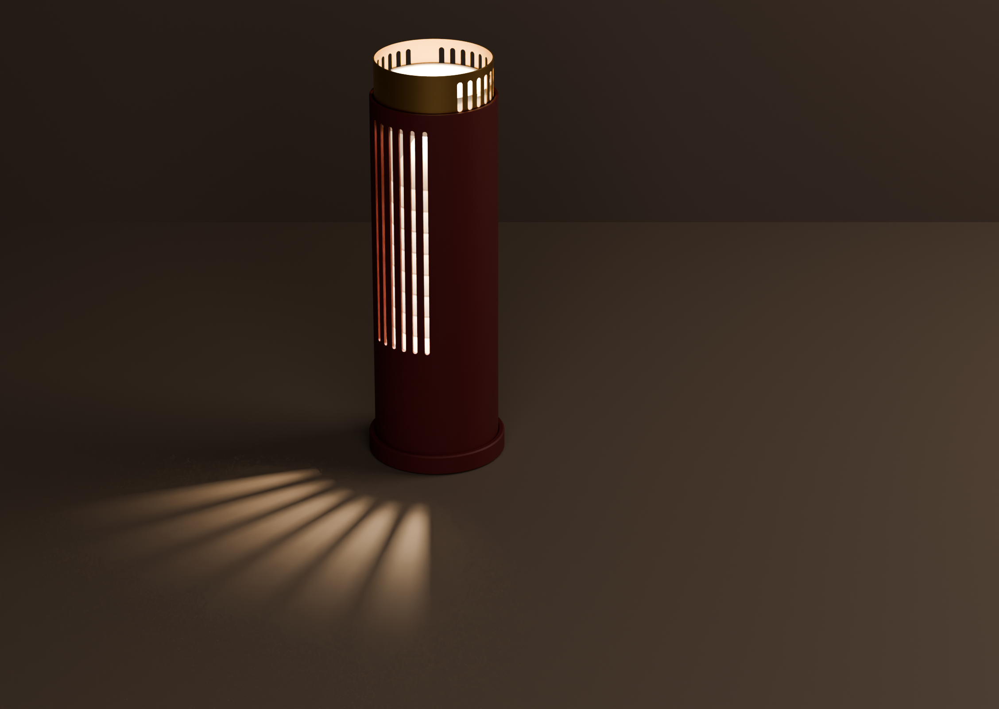

# FYR · konsept D

Revisjon v4, 2026-11-25. Generert av `cad/fyr_dokument.py` frå kontrollfilene.

Bordlampe for Northern. Ein mørk raud mantel med seks spalter, ein messingkrage som stikk opp av mantelen, og eit opalt lok inne i kragen. Kragen er den einaste betjeninga: du vrir han, og han opnar spaltene éi og éi som ein lukkar i eit fyr. Skissa er teken heilt fram til produksjonsklar CAD med kontroll, prentefiler, teikningar og montering.



## Hovudmål (serie)

| | |
|---|---|
| Høgd | 299 mm |
| Mantel | Ø90 x 2 aluminiumsrøyr, 257 mm synleg |
| Fot | Ø99 x 14 mm, 77 cm² på bordet |
| Krage | Ø83,7 messing 0,8 mm, 27 mm over mantelen |
| Masse | 1107 g (krav maks 1200 g) |
| Veltevinkel | 19,4° (tyngdepunkt 128 mm over bordet) |
| Effekt | ca 1,4 W på USB 5 V (sidelys 1,11 W + full glød 0,26 W, rekna), 0 W avslått |

## Korleis ho verkar

Kragen (05) går 0 til 90° i ni stillingar med 11,25° mellom (same deling som spaltene). Ein port i messingen dekkjer eller opnar spaltene, og tre mikrobrytarar under fotringen les vinkelen frå eit kamspor. Ingen elektronikk anna enn brytarar og motstandar: likestraum, ingen flimmer.

| Stilling | Kragen | Opne spalter | Brytarar lukka | Lys |
|---|---|---|---|---|
| 1 | 0,00° | 6 | SW1, SW2, SW3 | sidelys gjennom 6 spalter + full glød |
| 2 | 11,25° | 5 | SW1, SW2, SW3 | sidelys gjennom 5 spalter + full glød |
| 3 | 22,50° | 4 | SW1, SW2, SW3 | sidelys gjennom 4 spalter + full glød |
| 4 | 33,75° | 3 | SW1, SW2, SW3 | sidelys gjennom 3 spalter + full glød |
| 5 | 45,00° | 2 | SW1, SW2, SW3 | sidelys gjennom 2 spalter + full glød |
| 6 | 56,25° | 1 | SW1, SW2, SW3 | sidelys gjennom 1 spalte + full glød |
| 7 | 67,50° | 0 | SW1, SW3 | full glød i loket |
| 8 | 78,75° | 0 | SW1 | svak glød i loket |
| 9 | 90,00° | 0 | - | av (0 W) |

Lysrista (07) bak spaltene er bygd etter same logikk som Poul Henningsen sine skjermar: lamellar 55° ned og ut, med deling 16 mm mellom r 10 og 32. Ingen direkte stråle frå LED-stripa går ut flatare enn 36,9° under horisontalen på dei faktiske CAD-nettene (2D-vilkåret gjev 37,4°; kravet er 34°), så stripa er aldri synleg frå ein stol. Spegling i skjermar er ikkje rekna. Det du ser i spaltene, er kvite lamellar med mjuk glød. Det som når bordet, er strålar.

## Lys (rekna, ikkje målt)

- Ljosaste flate du kan sjå i spaltene frå sitjande augehøgd: **1264 cd/m²** (krav F1: under 3000; ønskje F5: under 1500). Stripa vart aldri treft av ei siktline.
- Strålar på bordet: middel **91 lx** 15 cm frå aksen (topp 128 lx, modulasjon 0,44), 47 lx på 20 cm.
- Lysstraum ut: ca **3,3 lm** gjennom spaltene + ca 14 lm frå loket ved full glød, til saman om lag 18 lm.
- **F3 (350 lx arbeidslys) er ikkje oppfylt**: middel 9,6 lx på 0,6 x 0,4 m. FYR er stemnings- og aksentlys, om lag som eit stearinlys. Dette er prisen for at kjelda aldri skal synast.
- Føresetnad: 100 lm/W for stripa (ikkje publisert av produsenten), kvit rist med refleksjon 0,8. Monte Carlo på parametrisk modell av den endelege rista, sjå `kontroll/fyr_lys.json`.

**Kontroll på dei faktiske CAD-nettene** (Blender BVH, første treff, heile lampa svart, `kontroll/fyr_lyskontroll.json`):

- Avskjering: 1 000 000 strålar frå stripa; den høgaste strålen som slapp ut, gjekk 36,9° under horisontalen (krav: minst 34° under): **bestått**
- Toppemitter: 250 000 strålar; 0 slapp ut utan å gå gjennom loket: **bestått**
- Augo: 480 000 siktliner frå 24 augeposisjonar; 0 treff på ein LED: **bestått**

## Delar

| ID | Del | Serie | Prototype (P1S) |
|---|---|---|---|
| 01 | Fot | EN AW-6082 dreia, 3 + 3 innpressa stift (bajonettknastar og stolpar for strekkavlastning), pulverlakk RAL 3005 | PLA Matte, prenta med botnen ned; knastane (Ø2,5) og stolpane (Ø3) er prenta med same mål |
| 03 | Chassis | SLS PA12 svart | PETG HF, tre-støtte |
| 04 | Mantel | røyr EN AW-6060 90 x 2, røyrlaser, pulverlakk | PLA Matte i to delar med fals (P1S tek 256 mm) |
| 05 | Hylse / krage | CuZn37 0,8 valsa frå laserskoren plate, børsta | PLA Silk+ gull 1,6 mm, prenta saman med fotringen |
| 05b | Fotring | POM-C: lager, klikkspor, kamspor, gjenger | som over |
| 05c | Stoppskruar | 3 x ISO 7380 M3 x 5: låser røyret, endestopp 0/90°, held kragen nede | same |
| 06 | Lysstav | aluminium 15 x 2 x 193, bak svart, limt i mastfoten og i rista | same |
| 06b | Sidestripe | 5 V COB 8 mm RA90, 158 mm | same |
| 06c | Toppemitter | 4 x 25 mm same stripe på kvadrat r 22 | same |
| 06d | Mastfot | POM-C 8 x 17 x 23,6, lomme for loddekroppen til 3,5 mm TRS-pluggen (limt), stavspor med leidningskanal | PETG HF på plate 4, same mål (lomma 0,2 større) |
| 07 | Lysrist | SLS PA12 kvit | PETG HF kvit, prenta opp ned |
| 08 | Lok | PLEXIGLAS Satinice WH02 3 mm | same eller diffusorark frå monitor |
| 10 | Glidering | POM-C delt ring | PETG HF |
| 11 | O-ring | silikon 85 x 3, strekt 2,9 % inn i sporet | same |
| 11b | Snorbitar | 3 x silikonsnor Ø2 x 10: forspenner bajonetten (trykk ned og vri) | same |
| 12 | Brytarar | Omron 2 x D2F-01L3 (gull) + D2F-L3 (sølv), justerbare ± 1,2 mm | same |
| 13 | TRS-kontakt | 3,5 mm panel M6 | same |
| 14 | Kort | R1 91 Ω, R3 33 Ω, PTC 0,5 A, JST PH | hullkort |

## Kontroll

- Alle 18 delane er gyldige B-rep-lekamar i både serie og prototype.
- Kollisjonar: 0 i serie og 0 i prototypen, prøvd i alle ni stillingane til kragen (132 par i serien). Rørslene har desse klaringane (serie / prototype): glidering 0,15 / 0,45 mm, tappen 0,20 / 0,30 mm, toppdekk mot mantel 0,15 / 0,30 mm.
- Kvar stilling er sjekka mot opne spalter og brytartilstand (tabellen over er skriven frå den kontrollen).
- **Ikkje gjort**: fysisk prøveprent, måling av lys, temperaturmåling, kabelstrekk-prøve. Sjå «Står att».

## Prentefiler (Bambu Lab P1S, 0,4 mm dyse, ferdig skorne)

| Fil | Delar | Filament | Tid | Gram | Støtte |
|---|---|---|---|---|---|
| `print/FYR_P1S_1_mantel_ovre_PLA-Matte-oksebloddraud.3mf` | 04b_mantel_ovre | Bambu PLA Matte | 5 t 19 min | 125 | nei |
| `print/FYR_P1S_2_mantel_nedre_og_fot_PLA-Matte-oksebloddraud.3mf` | 04a_mantel_nedre, 01_fot | Bambu PLA Matte | 3 t 5 min | 110 | nei |
| `print/FYR_P1S_3_hylse_PLA-Silk-messing.3mf` | 05_hylse_med_fot | Bambu PLA Silk+ | 2 t 54 min | 114 | ja |
| `print/FYR_P1S_4_chassis_glidering_mastfot_PETG-HF-svart.3mf` | 03_chassis, 10_glidering, 06d_mastfot | Bambu PETG HF | 3 t 42 min | 96 | ja |
| `print/FYR_P1S_5_lysrist_PETG-HF-kvit.3mf` | 07_lysrist | Bambu PETG HF | 5 t 8 min | 159 | ja |

Til saman om lag 20,2 timar og 604 g filament. Prent først ein prøvebit av fotringen (klikk og stoppskruar) før heile hylsa.

## Filer

| Mappe | Innhald |
|---|---|
| `cad/` | `fyr_geometri.py` (all geometri, éin parameterklasse), `fyr_bygg.py` (byggjer, eksporterer, kontrollerer), STEP per del og `fyr_samanstilling.step` |
| `kontroll/` | `fyr_CAD_verifisering.json`, `fyr_BOM.csv`, `fyr_innkjopsliste.csv`, `fyr_lys.json`, `fyr_lyskontroll.json`, `fyr_teikning_sjolvkontroll.json` |
| `cad/lysmodell/` | Monte Carlo-modellen som `kontroll/fyr_lys.json` kjem frå (sjå `cad/lysmodell/LES_MEG.md`) |
| `print/` | fem ferdig skorne 3MF-plater og `FYR_P1S_plater.json` |
| `produksjon/` | STL for prototypen, flatmønster for messinghylsa (DXF), lok (DXF), utbretta mantel (DXF) og `teikningar/` (produksjonsteikningar, PDF og PNG) |
| `montering/` | monterings- og servicerettleiing (PDF og PNG per side) |
| `render/` | Cycles-rendringar av CAD-en |

## Køyr på nytt

```powershell
py -3 cad/fyr_bygg.py
py -3 cad/fyr_print.py
py -3 cad/fyr_teikning.py
py -3 cad/fyr_montering.py
py -3 cad/fyr_dokument.py
```

Rendring og lyskontroll går i Blender 5.1. Eksporter netta først med `py -3 cad/fyr_render_eksport.py <stl_mappe> [theta]` (skriv `scene.json`), deretter `blender.exe -b -P cad/fyr_render.py -- <stl_mappe> <ut.png> <scene>` og `blender.exe -b -P cad/fyr_lyskontroll.py -- <stl_mappe> <ut.json>`. Sjå toppen av kvart skript.

## Avgjerder og avvik frå skissa

- Røyret er Ø90 x 2 fordi det er lagervare (Ø84, som skissa sine proporsjonar gav, finst ikkje). Alle proporsjonar er skalerte med.
- Kragen er Ø83,7 (0,93 av mantelen, skissa ca 0,94): det trengst ein glidering mellom messing og lakkert aluminium.
- Spaltene lyser mjukt mot toppen i staden for jamt heile vegen; øvre del får lys frå toppkammeret gjennom eit ope loft over rista. Fysisk ærleg: det er ikkje stripe over z 250.
- Ingen batteri. Lampa går på fast USB-kabel (B3). Batterimodul og trinnlaus dimming er ikkje med i denne utgåva (F7, F11 ikkje oppfylt); elektronikkrommet har plass til eit seinare kort med Hall-sensorar.
- Lysmodulen (stav, rist, toppemitter, lok) går ut gjennom kragen ovanfrå utan verktøy (B1, B7). Brytarar og kabel blir bytte etter at mantelen er vridd av.
- Mantelen går berre på i éin stilling (usymmetriske knastar), låser med klokka og må trykkjast ned for å løysast; slik kan ikkje drag frå kragen vri han laus. Tre klikktunger held fotringen sentrert; klikkmomentet er overslagsvis 0,3 til 0,4 Nm (ikkje målt).
- Funna frå dei uavhengige gjennomgangane (mekanikk, teikningar, rettleiing og leveranse) er retta i modellen og generatorane; kollisjons- og rørslekontrollen over er køyrd på resultatet.
- Messinghylsa er laga for laserskjering og valsing: hola Ø6 for stoppskruane har 1,7 mm steg ned til underkanten (krav minst 2 x 0,8 mm), og stumpskøyten ligg på 225°, midt mellom to kronegrupper. Når kragen blir vriden, vandrar skøyten mellom 225° og 135°, altså alltid på baksida.
- Kabelen er strekkavlasta i foten: han går i ein S rundt tre stolpar P1 til P3 (om lag 185° omslyng til saman, rekna med tangentar), og kappa sluttar før leiarane går opp i chassiset.
- Lysmodulen (stav, stripene, rista og mastfoten med pluggen) er limt saman med 2K-epoksy og blir bytt som eining. Ein tverrskrue mellom rista og staven fekk ikkje plass: over stripa står taket i vegen, og under stripa når ikkje skrujarnet fram forbi den nedste lamellen. Leiarane frå stripene går gjennom golvet i rista og ned i kanalen bak staven i mastfoten.
- Mastfoten (06d) er 8 mm brei slik at loddekroppen til TRS-pluggen (Ø6) får plass i ei lomme under staven; gjennomgangen i toppdekket er like brei pluss 0,3 mm klaring.

## Står att (ikkje verifisert)

- Prøveprent av fotring og klikk, deretter heile lampa; mål klaringane med skyvelære og juster `FyrParams.prototype()`.
- Mål kappeeininga og fargetemperaturen på stripa: spesifisert 2700 K, næraste lagervare hos BTF er 3000 K.
- Juster brytarhøgda ved montering (kontinuitetsprøve), og prøv R1/R3 på benken mot loket sin luminans.
- Temperatur på lysstav og rist etter 2 t ved full effekt (overslag 52 til 58 °C på staven, ikkje målt).
- Kabelstrekk 30 N og veltevinkel på skråplan (EN 60598-2-4): vinkel og verdiar er ikkje stadfesta i repoet.
- Spegling av spaltelyset i skjermar som hallar bakover er ikkje rekna.
- Prisar merkte NV i innkjøpslista.
