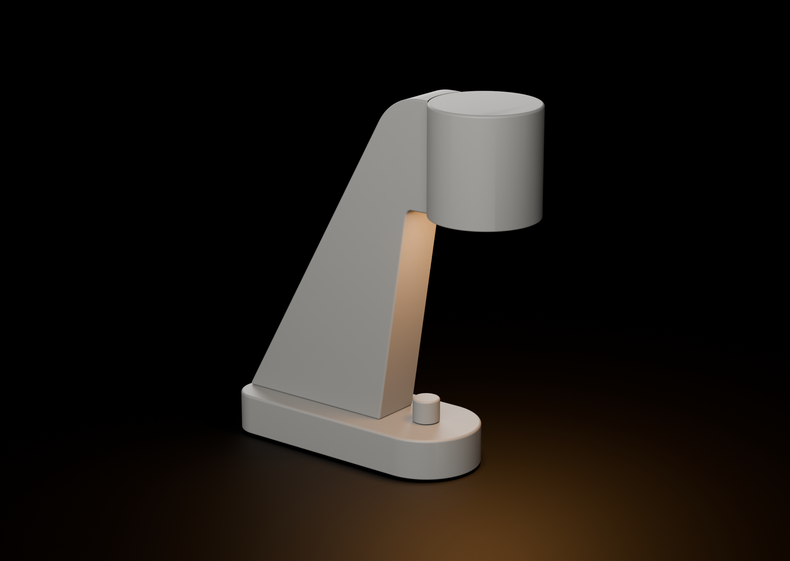

# Lut · konsept D

Bordlampe. Eit skrått blad står på ein flat fot og ber eit sylindrisk hovud som lyser ned på foten og bordet. Knotten står i lyset under hovudet: av, på og dimming.

Mappa går frå skissa til ferdig CAD-samanstilling, slica printplater og monteringsrettleiing. Alt blir laga på nytt frå skripta. Forma og djupna vart låste av brukaren 24.11.2026. Revisjon A er gjennomgått i to rundar med produksjonsrevisjon, og funna er retta (sjå «Status»).



## Mål

| | mm | Grunnlag |
| --- | --- | --- |
| Heile lampa | 244,5 × 80 × 274 | |
| Fot | 195 × 80 × 32 (skal 30 + føter 2) | lengd og høgd målt, djupn vald og låst |
| Blad | 40 tjukt; bakkant 29,4°, innerkant 8,7° frå loddrett | vinklane målt, tjukkleiken vald og låst |
| Hovud | Ø 80 × 80, aksen 204,5 frå venstre ende | målt |
| Avrunding øvst | R 40, same som hovudradien | målt R 39,8 |
| Knott | Ø 20 × 17,2, i senter av den runde enden av foten | målt Ø 20,0 og 1,7 mm lenger til venstre |
| Masse | om lag 1 040 g med stålplate, 670 g med PLA-plate | CAD og slicer |

Skissa har ingen målestokk. Eg valde 0,5 mm per pikselpunkt, slik at hovudet blir Ø 80 og knotten Ø 20. Då får kvar del plass på P1S-plata.

Opprisset er målt i skissa (`referanse/maaling.json`) og samsvarer 96 % med henne over foten. Talet står i `kontroll/overlegg.json`; sjølve overleggsbiletet ligg berre lokalt, saman med skissa. Under foten avvik det berre fordi skissa har perspektiv.

Djupna syner ikkje i skissa. Foten er 80 djup, like djup som hovudet er breitt. Bladet er 40 tjukt, lik radien til hovudet. Venstre ende av foten er rett og nett så brei som bladet, med R 20 i hjørna.

## Delar

| ID | Del | Tal | Materiale eller spesifikasjon | Kjelde |
| --- | --- | --- | --- | --- |
| D01 | Blad med kabelkanal | 1 | PLA matt grå | print |
| D02 | Hovud med magnetring | 1 | PLA matt grå | print |
| D03 | Fot (skal) | 1 | PLA matt grå | print |
| D04 | Botnplate, ballast | 1 | stål S235 4 mm frå DXF, 4 hol senka 90° til Ø 7 nedanfrå (alternativ: PLA, plate 4, utan ballast) | laser / print |
| D05 | Knott | 1 | PLA matt grå | print |
| D06 | Lyskopp med kabelspalte | 1 | PETG kvit | print |
| D07 | Spreiar Ø 71 | 1 | opal PC 1 mm eller eit LCD-diffusorark | skjer ut etter DXF-mal |
| D08 | Kjøleplate Ø 50 × 1,5 | 1 | aluminium, Ø 6-hol i senter, festa med termisk teip | skjer ut etter DXF-mal |
| E01 | LED-modul Ø 50, 5 V, 2700 K, CRI ≥ 90 | 1 | ≤ 1,5 W med hovudet i PLA, ≤ 2 W med hovudet i PETG (plate 5); loddepunkt + og − på LED-sida ved kanten | kjøp |
| E02 | Potensiometer med brytar, WH148 16 mm | 1 | M7 × 0,75-hals 7 mm (6,6–7,4), riflet aksel Ø 6 kappa til 15 mm frå monteringsflata, låsetapp | kjøp |
| E02b | Mutter og skive M7 | 1 | følgjer E02 | kjøp |
| E03 | PWM-dimmarkort | 1 | verkar frå 4,5 V, PWM ≥ 3 kHz, ≥ 1 A, E02 lodda på kortet | kjøp |
| E04 | USB-C-hokontakt for panel | 1 | 2 pinnar, innebygde 5,1 kΩ på CC1 og CC2 kvar for seg | kjøp |
| E05 | Kabel til LED | 1 | 2 × 0,25 mm² silikon, 650 mm, kappa til slutt | kjøp |
| E06 | Leidning i foten | 2 | 0,25 mm² raud og svart, 120 mm | kjøp |
| M01–M09 | Beslag og forbruk | | 3 + 6 innpressmutrar (M4 × 8,1 og M3 × 5,7), skruar 3 × M4 × 16, 2 × M3 × 10, 4 × M3 × 8 senkskrue, 6 magnetar Ø 6 × 3, 4 gummiføter, 2 termisk teip Ø 50, kaptonteip 60 × 40 | kjøp |

Heile lista med mengder og masse ligg i `kontroll/lut_stykkliste.csv`. Lampa går på 5 V frå ein vanleg USB-C-ladar, så det er ingen nettspenning inne i ho.

## Print

Bambu Lab P1S, 0,4 mm dyse, Textured PEI. Slica med Bambu Studio-CLI og systemprofilane (`print/slice_lut.py`, resultat i `print/slicing.json`). G-koden har ingen støtte på nokon plate, og sliceren gav ingen åtvaringar. Verktøybanene er teikna i `print/baner/` (`print/teikn_baner.py`).

| Plate | Innhald | Filament | Profil | Tid | Gram |
| --- | --- | --- | --- | --- | --- |
| 0a | Passprøve for bladet | PLA Matte | som plate 1, utan stryking | 0 t 20 | 12 |
| 0b | Passprøve for hovud, fot og knott | PLA Matte | som plate 2 | 0 t 37 | 17 |
| 1 | D01 Blad, liggjande | PLA Matte | 0,20 Standard, 5 vegger, 6 topp- og botnlag, 20 % gyroid, stryking | 8 t 34 | 309 |
| 2 | D03 Fot, D02 Hovud, D05 Knott, alle opp-ned | PLA Matte | 0,16 Optimal, 6 vegger, 15 % gyroid | 3 t 44 | 178 |
| 3 | D06 Lyskopp, opp-ned | PETG HF kvit | 0,16 Optimal, 4 vegger | 0 t 37 | 19 |
| 4 | D04 i PLA, berre om du ikkje har stålplata | PLA Matte | 0,20, 100 % | 0 t 59 | 72 |
| 5 | D02 Hovud i PETG, reserve om hovudet blir for varmt | PETG HF | 0,16 Optimal, 6 vegger | 2 t 04 | 80 |

Ei lampe tek platene 0a, 0b, 1, 2 og 3: om lag 13 t 51 min og 534 g filament.

Dei slica filene frå CLI-en manglar førehandsbilete og `printer_model_id`. Opne geometrifila (`.3mf` utan `gcode`) i Bambu Studio med P1S-profilen, slice og bruk «Export plate sliced file» før du sender til printaren. Innstillingane står i tabellen.

Print plate 0a og 0b først. Kvar prøve er printa med same innstillingar og i same retning som delen ho står for: 0a som bladet, 0b som hovudet, foten og knotten. Prøv:
- 0a: dei to innpressmutrane i klossen (M4 og M3, hola ligg som i bladet), og styretappen (Ø 8), som skal gli gjennom holet i veggen på 0b (Ø 8,9);
- 0b: M3-mutteren i tårnet, som i foten, og magneten i lomma;
- 0b: potensiometeret, med halsen gjennom panelet på 3 mm og tappen i ei av lommene;
- 0b: knottstubben, som skal pressast på akselen og stoppe mot halsen;
- lyskoppen frå plate 3: magnetane i lommene i PETG, og koppen inn i ringen på 0b med litt luft.

Om noko er for trongt eller for laust, rett målet øvst i `cad/lut.py` og køyr skripta på nytt.

Bestill stålplata først når foten er printa, og mål falsen i botnen: han skal vere minst 192,0 × 77,0 mm. Plata er 191,6 × 76,6 mm.

Framsida av bladet ligg mot plata og får teksturen frå henne. Baksida blir stroken toppflate. Vil du ha like flater, slip og lakker bladet.

## Montering

`montering/Lut-montering.pdf` har tretten sider med strekteikningar rett frå CAD-en, med same ID-ar som her. Stega er desse:
1. Innpressmutrane.
2. Éi limøkt med 24 timars herding: magnetane med tusjmerke for polen, og USB-C-kontakten med E06 lodda på, ned bak ribba og ut i lomma, med epoksy i spalta.
3. Kabelen gjennom bladet, og hovudet på frå innsida.
4. Potensiometeret i foten, med akselen kappa til 15 mm frå monteringsflata.
5. Kabelen ned gjennom foten, og bladet på, handstramt.
6. LED-en i koppen: knute på kabelen over spalta, kjøleplata og LED-kortet med termisk teip, loddepunkta på framsida.
7. Kopling og lysprøve med foten open.
8. Spreiaren og koppen inn i hovudet.
9. Kaptonteip, botnplate, føter og knott.

## Status

| Kontroll | Resultat | Korleis |
| --- | --- | --- |
| Gyldige solidar | alle 32 delar, beslag og kjøpte delar | OCC `isValid` |
| Kollisjonar | 0 av alle par | boolsk snitt, terskel 0,01 mm³ |
| Monteringsvegar | fri for lyskopp, hovud på blad, knott, botnplate og USB-C-kontakten (2,4 mm attende, inn, så ut i lomma) | diskret, steg på 1 mm (USB-C 0,2 mm) |
| Velting | 22° framover og bakover, 40° mot hovudet (stål); 15° med PLA-plate | statisk, om ytterkanten av føtene; EN 60598-1 krev 6° |
| STL | alle tette; bladet var utett i fire hjørne (trekantar med null areal) og er reparert | trimesh, kvar eksport |
| Print | alle delar passar P1S; 7 plater slica, ingen støtte i G-koden, alle banesegment typa | Bambu Studio-CLI; G-koden lesen etter `; FEATURE:`-merka |
| Revisjon | runde 1: 48 funn, 37 stadfesta og retta. Runde 2 kontrollerte rettingane og fann sju opne og fleire nye feil. Dei er retta: halsen på potensiometeret, luft bak USB-C-kontakten, passprøva delt i 0a og 0b, PETG-hovud på plate 5, eitt limesteg, termisk teip på kjøleplata og figurane i rettleiinga | fem fagområde, kvar med motprøve |
| Fysisk prøve | ikkje gjort | print plate 0a og 0b først |
| Varme | ikkje prøvd | E01 er sett til ≤ 1,5 W med hovudet i PLA. Etter 60 min på full styrke: LED-kortet ≤ 60 °C og koppen under magnetringen ≤ 45 °C; elles svakare LED eller hovudet i PETG (plate 5, toler 2 W) |
| Kjøpte delar | nominelle mål, ikkje målte | mål potensiometer, dimmar og USB-C med skyvelære før plate 2 |

## Serieproduksjon

Geometrien held òg for serie. Då blir blad og hovud éin pressstøypt aluminiumsdel utan skøyt, og foten blir støypt i sink, så stålplata fell bort. Knotten blir dreidd i aluminium, og alt blir pulverlakkert i same grå. Delinga i printutgåva (hovudet skrudd på bladet, botnplate i stål) er der for at P1S skal klare delane utan støtte.

## Filer

| Mappe | Innhald |
| --- | --- |
| `cad/` | `lut.py` (kjelda, alle mål som parametrar øvst), STEP per del og `lut_samanstilling.step` med fargar |
| `produksjon/` | STL per del i monteringsposisjon, DXF i 1:1 for botnplata (laser), spreiaren og kjøleplata (malar), `P00a_passprove_blad.stl` og `P00b_passprove_hovud_fot.stl` |
| `print/` | printplatene som 3MF (geometri) og `.gcode.3mf` (slica), `slice_lut.py`, `slicing.json`, verktøybanene i `baner/` |
| `kontroll/` | `lut_kontroll.json`, `lut_delar.json`, `lut_stykkliste.csv`, `overlegg.py`, `overlegg.json` |
| `render/` | rendringar i Cycles frå CAD-nettet, `render_lut.py` |
| `montering/` | `Lut-montering.pdf`, sidene som PNG, `lag_rettleiing.py` |
| `referanse/` | `maaling.json`. Skissa, overleggsbiletet og samanlikninga skisse mot CAD ligg berre lokalt til opphavet er avklara, fordi repoet er offentleg. |

Køyr frå denne mappa:

```
py -3 cad/lut.py
py -3 print/slice_lut.py
py -3 print/teikn_baner.py
blender -b -P render/render_lut.py -- oppriss tre_kvart venstre bak sprengt ovanfra
py -3 montering/lag_rettleiing.py
py -3 kontroll/overlegg.py      # krev skissa lokalt
```
