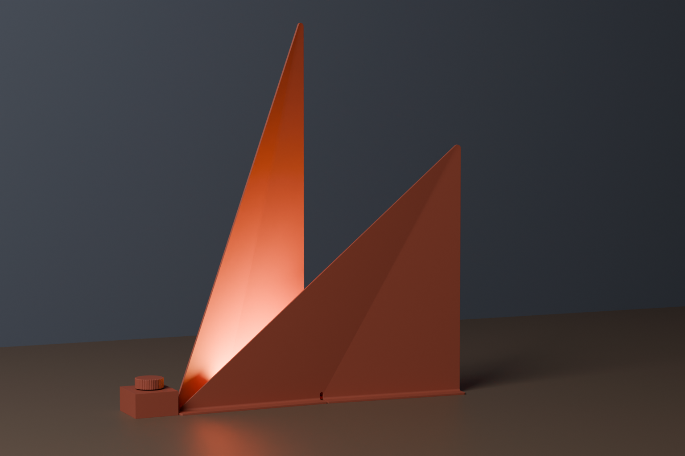

# SEGL · konsept D · produksjons-CAD (1:1 mm · 305 mm høg)

To bretta segl i pulverlakkert stålplate og ei lita klampe med dreieknapp. Framseglet skjermar lyset, høgseglet tek imot det. LED-stripa ligg skjult nede i V-en og lyser opp innsida av høgseglet.



## Tal

| | |
| --- | --- |
| mål | 279 × 77 × 305 mm (klampe til ytterkant, flens til høgsegl, bord til topp) |
| masse | 750 g |
| fotavtrykk | 137 cm² (hylster rundt alt som står på bordet) |
| veltevinkel | 25,7° i den svakaste retninga (fram over flenskanten) |
| lys | 174 lm frå stripa, om lag 60 til 80 lm ut i rommet etter første sprett (rekna, ikkje målt) |
| luminans | høgst 1845 cd/m² på innsida av høgseglet ved full styrke |
| effekt | 2,25 W på stripa, om lag 2,6 W frå USB-C |
| fargetemperatur | 3000 K ved full styrke, ned mot 1800 K når ho blir dempa (stripa gjer det sjølv) |

## Delane

| pos | del | materiale |
| --- | --- | --- |
| D01 | framsegl med fotflens og tunge | DC01 1,5 mm, pulverlakk |
| D02 | høgsegl med golv og leppe | DC01 1,5 mm, pulverlakk |
| E01 | lysberar med LED-stripe | EN AW-5754 1,5 mm, pulverlakk (setet maskert) |
| E02 | klampe (skal og botnplate) | EN AW-6082 fresa, pulverlakk / 5754 1,5 mm |
| E03 | knapp, rett rifling | EN AW-6082 dreia, pulverlakk |
| E04 | kretskort med enkoder og USB-C | FR4 |

Sju hovuddelar (krav T6: høgst ti). Smådelar H01 til H07 står i `kontroll/segl_BOM.csv`.

## Korleis delane heng saman

- **D01 og D02:** golvet til høgseglet ligg på bordet inne i V-en. Leppa på golvet ligg mot innsida av framseglet og er skrudd fast på tre sveiseboltar M3 med flensmutrar. Ingen skruar synest utanfrå.
- **Lysmodulen (E01):** står på to sveiseboltar i golvet og blir halden av to rifla mutrar. Han kan takast ut for hand (krav B1).
- **Klampa (E02):** sit på ei tunge på fotflensen til framseglet, med to senkskruar M2,5 nedanfrå. Leidningen går flat langs bordet inne i V-en, frå klampa til lysmodulen.

## Kva som er målt, og kva som er valt

Mål frå skissa er lesne med eit kamera som er passa til biletet (`cad/segl_mot_skisse.py`, `kontroll/segl_mot_skisse.png`). CAD-kantane ligg innanfor 8 til 10 px av skissa (om lag 3 mm). Alle tal står med opphav (MÅLT, VALT, DATABLAD, ANTEKE) øvst i `cad/segl_geometri.py`.

Skalaen er ankra i høgda på framseglet, 205 mm. Då blir knappen Ø22, og det er ein rimeleg storleik.

**Valt, ikkje målt:**
- Kor djupt høgseglet står bak. Biletet kan ikkje skilje vinkelen; han er sett til 26° og 16° (fald 10,4°). Skuggen på det smale feltet avgjer kva veg falden går.
- Falden på framseglet er 5,8° og ikkje 1 til 2° som biletet tyder på. Kantpressa bøyer ikkje mindre enn 5°.

**Vedteke av brukaren 24.11.2026:** knappen er terrakotta som resten av lampa, ikkje messing. Northern-trekket H5 (eitt messingpunkt) er då medvite brote.

**Avvik frå skissa:**
- Ved foten av kvar fald er det eit relieff, på framseglet ei spalte 3 × 7 mm, og ei glipe på 1,6 mm i fotflensen. Platearbeid krev det. Spalta kan sveisast att og slipast før lakkering.
- Alle frie spissar har R3, av omsyn til tryggleik (EN 60598-1 4.25).
- LED-stripa er 125 mm og ligg berre der høgseglet skjermar henne bakfrå. Ei lengre stripe synest bakfrå og i ein skjerm bak lampa (sjå lys).

## Lys og blending (`cad/segl_lys.py`, `kontroll/segl_lys.png`)

- **F1:** framfrå er stripa skjult frå bordflata opp til 60° høgd. Bakfrå er ho òg skjult opp til 60°, så ein skjerm bak lampa speglar henne ikkje.
- **Langs V-en:** frå klampe-enden og frå den opne enden synest stripa over om lag 15 til 20°. Det følgjer av forma, som er open langs V-en. Ein klipsa opal diffusor er mogleg seinare, men han gjer ikkje luminansen låg nok til å vere usynleg.
- **F5:** ved full styrke er det lysaste punktet på høgseglet 1845 cd/m², over målet på 1500. Under om lag 80 % held det.
- **F3 er ikkje nådd:** 350 lx på arbeidsfeltet krev langt meir lys enn ei indirekte terrakottaflate gjev. Segl er ei stemningslampe.

## Kontroll (`kontroll/segl_CAD_verifisering.json`)

- **Lekamar:** alle delar er gyldige og lukka.
- **Kollisjonar:** ingen mellom nokon av dei 18 delane, utanom skruegjengane som er meinte.
- **Utbretting:** kvar plate er eitt emne, og ingen spalte i emnet er smalare enn 1,6 mm.
- **Lekamar til print:** alle er vasstette.

**Ikkje gjort:**
- slicing
- fysisk prøve av passingar og bøyar
- prøveplate for sveiseboltar under lakk
- måling av lys og varme
- pristilbod frå verkstad
- utlegg av kretskortet og fastvare

K-faktoren 0,40 er anteke. Den bretta STEP-fila er fasit for verkstaden.

## Filer

| mappe | innhald |
| --- | --- |
| `cad/` | `segl_geometri.py` (mål), `segl_cad.py` (delar, kontroll, eksport), `segl_utbretta.py`, `segl_lys.py`, `segl_teikning.py`, `segl_render.py`, `segl_print.py`, `segl_mot_skisse.py`, STEP per del og `segl_samanstilling.step` |
| `produksjon/` | utbretta DXF for D01, D02, E01 og botnplata (lag SKJER, BOY, MERKE, TEKST), `boyetabell.csv`, STL, `segl_mal_1til1.pdf` (pappmodell 1:1 på A3) |
| `print/` | `Segl_prototyp_P1S_PETG.3mf` og STL: klampe, botnplate, knapp, lysberar (usliced) |
| `montering/` | `Segl_maalteikning_A3.pdf`, `Segl_monteringsrettleiing.pdf` (9 sider), PNG per side |
| `render/` | skissevising, dagslys, sprengt (Cycles, frå CAD-en) |
| `kontroll/` | verifisering, BOM, innkjøpsliste, lys, samanlikning med skissa |

Køyr frå `cad/`, i denne rekkjefølgja:

```
python segl_cad.py
python segl_utbretta.py
python segl_lys.py
python segl_teikning.py
python segl_print.py
python segl_mot_skisse.py
blender.exe -b -P segl_render.py -- <nettingmappe> ../render skisse dag sprengt
```
