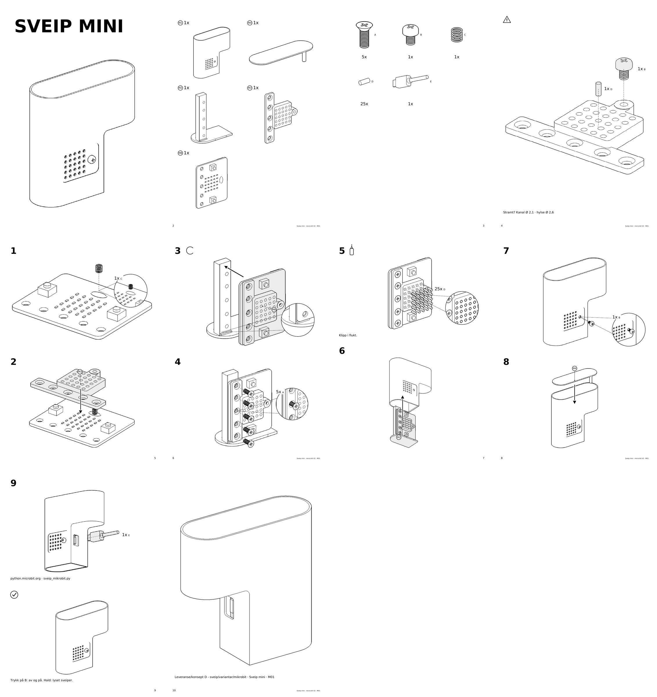

# Monteringsrettleiing for Sveip mini, M01



Rettleiinga har 10 sider i IKEA-stil. Ho er laga med skillen `ikea-rettleiing` og `verktoy/ikea/bygg.py` frå [formnerd](https://github.com/lukketsvane/formnerd), greina `claude/ikea-manual-skill`. PDF-en ligg i `ut/rettleiing.pdf`, og sidene ligg i `ut/sider/`. Printfiler, innkjøp og kontrollar står i `../LES_MEG.md`.

## Bygg på nytt

```bash
python3 lag_delar.py                                             # delane i lampa som STL, og posisjonar.json
python3 lag_spesifikasjon.py                                     # spesifikasjon.json
python3 <formnerd>/verktoy/ikea/bygg.py spesifikasjon.json ut    # PDF, sider, kontaktark og rapport
```

Det krev cadquery, trimesh og reportlab, og node med three (`npm install --prefix <formnerd>/verktoy`). Det krev òg Playwright med Chromium.

## Rekkjefølgja

| Steg | Handling | Kvifor her |
| --- | --- | --- |
| | Prøv eit stykke filament (D) i ein kanal og messingskruen (B) i hylsa på lysrista (M3) | Små hol blir trykte for små. Hylsa blir òg gjenga før monteringa |
| 1 | Fjøra (C) ståande på logoen, med kortet framsida opp | Lomma i lysrista opnar mot kortet, så fjøra må stå på kortet først |
| 2 | Lysrista (M3) ned over kortet | Lommene går over LED-ane og hylsa over fjøra |
| 3 | Kortet med rista mot stolpen på chassiset (M2), inn mot kanten og ned på hylla | Kanten og hylla set kortet, så spelet i ringane ikkje flyttar LED-ane |
| 4 | 5x A gjennom rista og ringane og inn i stolpen | Låser kort, rist og chassis til éin pakke |
| 5 | 25x D i kanalane, limte og klipte i flukt | Rista må stå fast. Ein leiar som stikk fram, sperrar i steg 6 |
| 6 | Chassiset opp i stamma (M1) nedanfrå | Ribbene på golvet klemmer |
| 7 | Messingskruen (B) gjennom feltet og inn i hylsa | Han held chassiset og gjev kontakt til logoen gjennom fjøra |
| 8 | Lysplata (M4) ned i skjermen | Ligg på stolpen og to bein |
| 9 | USB-kabelen (E) gjennom endeplata, og fastvara | Kortet kan programmerast i lampa |
| | Kontroll: trykk og hald på B | Trykk slår av og på. Held du, sveiper lyset |

## Kva som er kontrollert

- **Delane** er dei same lekamane som i `../print/` og har same ID (M1–M4). micro:bit-en (MB) og beslaga er modellerte etter monteringsteikninga for V2 og innkjøpslista.
- **Mengdene** i stega stemmer med dellista. `ut/rapport.json` har ingen åtvaringar.
- **Rekkjefølgja og innføringsretningane** følgjer passformkontrollen i `../mini_print.py`. Chassiset med kortet kjem opp i stamma nedanfrå utan å ta borti noko, og lysplata kjem ned i skjermen.
- **Ikkje prøvd:** nokon fysisk montering, og kor store hola blir i print. Difor står portsida før steg 1.

## Avvik frå IKEA

- Skrifta er DejaVu Sans.
- Det er ingen hender, og ingen par med rett og feil. Leiarane er rette liner.
- Tre stader står ein kort tekst: holmåla på portsida, «Klipp i flukt» og adressa til fastvara.
