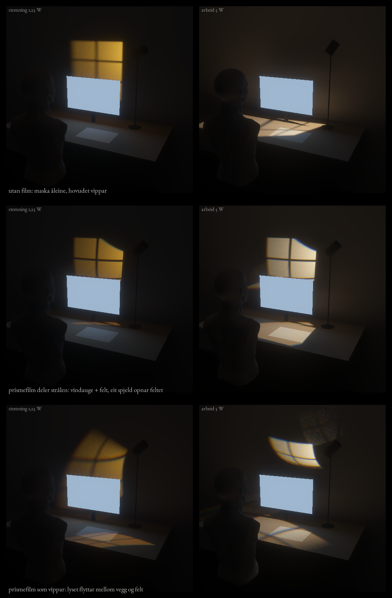
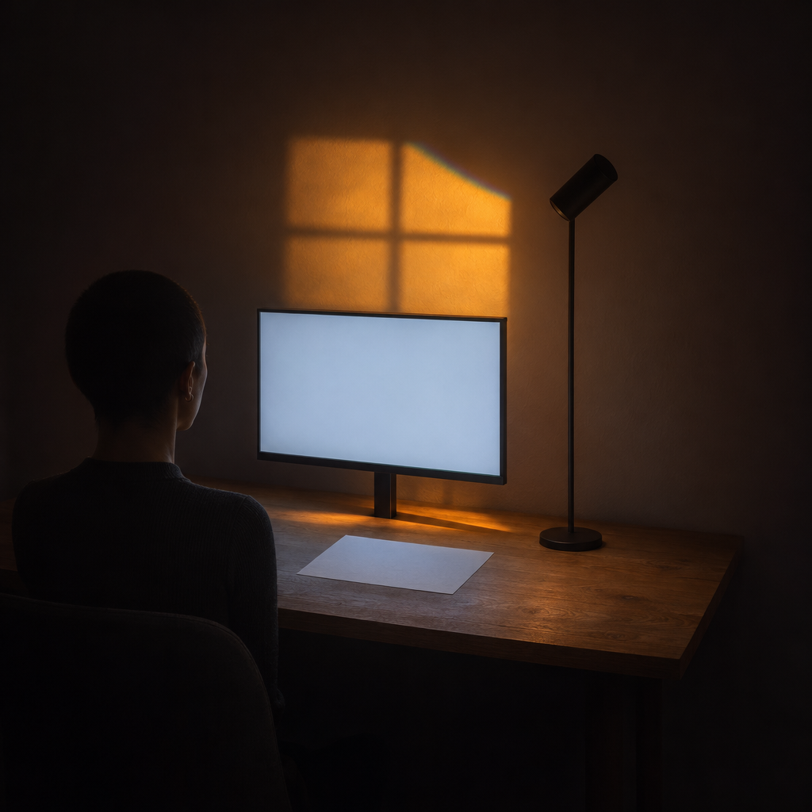

# Varmt vindauge utan linse

Dato: 13.11.2026. Ei lita diode, ei maske og prismearket frå monitoren kastar eit vindauge av lys på veggen bak skjermen. Alt her er modell, ikkje måling. Arket er rekna som eit ideelt 90°-prisme (ANTAKING) til det er målt. Rommet, wattane og tala er dei same som for A, B og C (`konsept/tre/`). Skripta er `film.py`, `kast.py` og `vindauge.py`, sjå `API.md`.

Biletet over er ein generert illustrasjon (GPT Image), laga frå stemningsruta for «spjeld» i simuleringa. Mønsteret og plasseringa er frå simuleringa, materiala og lyset elles er dikta.

## Kva filmen gjer

Kvart foton er spora gjennom prismeprofilen med bryting, totalrefleksjon og Fresnel-tap, per bølgjelengd.

| Lys inn | Lys ut |
| --- | --- |
| Mot prismesida, rett på | to lober, 30,8° til kvar side, 47 % i kvar. 7 % blir kasta attende |
| Mot prismesida, vippa 10° / 20° / 30° | lobene får 53 og 38 % / 60 og 27 % / 62 og 15 % |
| Mot prismesida, vippa 40 til 50° | 3 % kjem gjennom. Filmen er ein spegel |
| Mot flatsida, rett på | ingenting kjem gjennom. Alt blir kasta attende |
| Mot flatsida, 30° | éi lobe rett ut av filmen, 63 % |
| Blått (450 nm) mot raudt (650 nm) | 31,6° mot 30,2°. Fargekanten er 1,4° brei, om lag 12 mm på ein vegg 50 cm unna |

Sporinga treffer formelen for splittvinkelen (30,69° ved 550 nm). Linjer langs rillene blir bogar i kastet. Linjer på tvers av rillene held seg rette.

## Tre grep

Hovudet står 65 cm over bordet, over høgre skjermhjørne, som i C. Frå den plassen er vinkelen mellom veggen bak skjermen og arbeidsfeltet om lag 60°. Det er vinkelen filmen deler med. Éi diode og éin film gjev difor vindauge på veggen og lys på feltet samstundes.

- **Open:** inga film. Maska åleine teiknar vindauget. Hovudet vippar frå veggen ned på feltet.
- **Spjeld:** filmen står fast og deler strålen. Ei plate 5 cm etter filmen har éi opning for vindauget og éi for feltet. Eit spjeld opnar feltopninga.
- **Vipp:** filmen vippar om rilleaksen. Lyset flyttar seg mellom dei to lobene.

## Tala

Naken diode, 2 mm, lambertsk (ANTAKING). Arbeid er 5 W, stemning 1,25 W.

| | Open | Spjeld | Vipp |
| --- | --- | --- | --- |
| Del av lyset som kjem ut | 0,11 | 0,09 | 0,07 |
| Feltet ved 5 W, lx | 116 | 89 | 61 |
| Watt for 350 lx på feltet (tak 7,5) | 15,1 (ikkje halde) | 19,7 (ikkje halde) | 28,6 (ikkje halde) |
| Jamnheit på feltet (referanse 0,6) | 0,01 | 0,06 | 0,03 |
| Veggen bak skjermen ved 350 lx (F6 100 til 150) | 14 | 239 | 160 |
| Skjermflata ved 350 lx | 96 | 39 | 43 |
| Mot auget ved 350 lx, cd/m² (F5 1500) | 127 | 315 | 403 |
| Stemning: veggen bak skjermen, lx | 31 | 14 | 11 |
| Stemning: feltet, lx | 1 | 1 | 4 |
| Stemning: mot auget, cd/m² (krav 500) | 35 | 18 | 10 |
| Likskap stemning og arbeid (over 0,9 er dimmar) | 0,00 | 0,82 | 0,77 |
| Største sprang langs overgangen | 0,30 | 0,02 | 0,04 |

Same grep med ei kjelde som har eigen optikk (lykt). Sigma er spreiinga i strålen, diameteren er den lysande flata.

| Kjelde | Open: W for 350 lx | Spjeld: W for 350 lx | Spjeld: del ut | Spjeld: stemning bak skjermen, lx |
| --- | --- | --- | --- | --- |
| Naken diode, 2 mm | 14,8 | 19,6 | 0,09 | 15 |
| Sigma 25°, 4 mm | 6,3 | 8,0 | 0,22 | 34 |
| Sigma 15°, 6 mm | 2,7 | 3,7 | 0,46 | 67 |
| Sigma 10°, 8 mm | 1,6 | 2,4 | 0,67 | 98 |

## Kva det tyder

1. **Vindauget utan linse held som stemning.** Med naken diode og 1,25 W gjev det 11 til 31 lx på veggen bak skjermen, med mjuk skuggekant som frå låg sol, og under 40 cd/m² mot auget.
2. **Det held ikkje som arbeidslys med naken diode.** Berre 7 til 11 % av lyset kjem gjennom maska, så 350 lx på feltet krev 15 til 29 W. Taket er 7,5 W. Årsaka er geometrisk: ei lita diode lyser i alle retningar, og maska slepper berre gjennom det som peikar mot vindauget og feltet.
3. **Ei kjelde med eigen optikk snur dette, mot ein pris.** Med ein liten kollimator (sigma 10 til 15°) held 2,4 til 3,7 W. Men den lysande flata blir 6 til 8 mm, og skuggekanten blir tilsvarande mjukare. Sprossene må då stå langt frå kjelda for å synast.
4. **Filmen løyser overgangen utan å sveipe over skjermen.** Spjeld og vipp deler strålen, som C. Skjermflata får 39 til 43 lx ved 350 lx. Open flyttar strålen og legg 96 lx på skjermen.
5. **Vipp åleine er for lite.** Lobene går frå om lag 4:1 til 1:4. Likskapen er 0,77, så det er ein overgang, men feltet får alltid noko av vindauget og veggen alltid noko av feltlyset.
6. **Jamnheita på feltet er ikkje løyst.** Opninga for feltet er teikna som om filmen dreidde heile strålen stivt. Det gjer han ikkje: biletet blir pressa saman på tvers av rillene. Opninga må teiknast frå sporinga. Tala 0,01 til 0,06 seier difor at feltet ikkje er dekt, ikkje at grepet er umogleg.
7. **Fargekanten og bogane er eigenskapar, ikkje feil.** Vindauget får boga overkant og ein smal regnboge langs kantane som går med rillene.

## Det som ikkje er rekna

- Hette framfor filmen. Bileta viser lys som slepp ut til venstre i hovudhøgd (svake sidelober). Auget står ikkje i det i modellen, men det må skjermast.
- Kva arket faktisk er. Fotoa viser samanhengande striper, så prisma kan vere avrunda eller ha ein spreiar i tillegg. `Film` tek profil, ekstra spreiing og diffus del som parametrar.
- Kva kjelda er. Storleiken og spreiinga til telefonlykta avgjer både verknadsgrad og skuggekant, og er ikkje målt.

## Prøve som avgjer mest

Lykta 30 cm bak arket og eit kvitt kort 30 cm framfor, i mørkt rom, med prismesida mot lykta. Modellen seier: to flekkar, 36 cm frå kvarandre (2 · 30 cm · tan 30,8°), like sterke, med blått ytst og raudt inst og om lag 10 mm fargekant. Snu arket: flekken rett fram blir borte. Vipp arket 30° om rillene: den eine flekken blir fire gonger sterkare enn den andre. Stemmer ikkje dette, er arket noko anna enn eit 90°-prisme.
