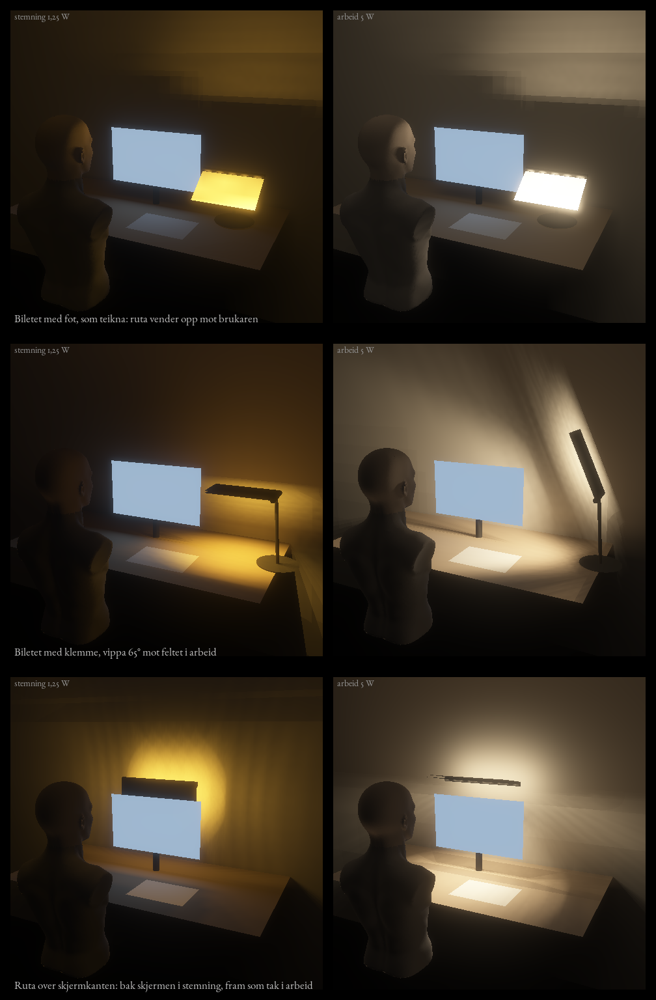

# Filmen som rute

Dato: 13.11.2026. Dei to lampene på bileta frå i dag (ei rute på arm med fot, og ei rute som tak på klemme) er rekna i same rom og med same tal som A, B og C. Alt er modell, ikkje måling. Arket er rekna som ideelt 90°-prisme (ANTAKING). Skripta er `rute.py`, `rute_sok.py` og `rute_tre.py`.

## Kva filmen gjer som framside på ei lysande rute

Ruta er eit flatt, kvitt hus med dioder og ein spreiar, og filmen ligg ytst. Det filmen kastar attende, blir spreidd på nytt i huset (ANTAKING: 90 % kjem ut att). Tala er lysstyrke i candela per 1000 lumen frå diodene.

| Framside | Rett ut | 40 til 50° på tvers av rillene | 70° på tvers | 60° og meir langs rillene | Del av lyset ut |
| --- | --- | --- | --- | --- | --- |
| Matt spreiar åleine | 290 | 170 til 200 | 100 | 65 til 140 | 0,90 |
| Filmen, prisma ut | 570 | 10 til 15 | 160 | 0 | 0,89 |
| To ark i kryss, prisma ut | 1010 | 25 til 250 | 0 | 60 til 170 | 0,68 |
| Filmen, prisma inn | 0 | 340 til 380 | 180 | 0 | 0,89 |

Med prisma ut dobler filmen lyset rett fram, og han sender ingenting ut frå 60° og meir langs rillene. Det siste er nøkkelen: peikar rillene mot auget, og auget ser ruta frå sida, er ruta mørk. Med prisma inn er ruta mørk rett forfrå og lyser ut til sidene.

## Dei to lampene og ei tredje plassering

Filmen har prisma ut i alle. Arbeid er 5 W og stemning 1,25 W, og arbeidstala er skalerte til 350 lx på feltet.

| | Rute på fot, som teikna | Rute på klemme, som teikna | Rute på klemme, vippa 65° | Ruta over skjermkanten | Same, matt spreiar |
| --- | --- | --- | --- | --- | --- |
| Watt for 350 lx på feltet (tak 7,5) | 128 (ikkje halde) | 10,7 (ikkje halde) | 6,2 | 3,7 | 6,6 |
| Jamnheit (referanse 0,6) | 0,87 | 0,03 | 0,45 | 0,62 | 0,70 |
| Veggen bak skjermen (F6 100 til 150) | 276 | 112 | 158 | 147 | 333 |
| Skjermflata, lx | 397 | 55 | 123 | 187 | 298 |
| Mot auget 25 / 47 / 60 cm, cd/m² (F5 1500) | ikkje halde | 13 540 / 663 / 663 | 562 / 143 / 377 | 1001 / 74 / 74 | 2018 / 2294 / 1984 |
| Stemning: mot auget, cd/m² (krav 500) | 62 / 1030 / 1294 | 1581 / 80 / 80 | 1581 / 80 / 80 | 148 / 148 / 148 | 113 / 113 / 113 |
| Stemning: veggen bak skjermen, lx | 3 | 13 | 13 | 217 | 196 |
| Likskap stemning og arbeid (over 0,9 er dimmar) | 1,00 | 1,00 | 0,79 | 0,47 | 0,57 |
| Lysaste mellomsteg mot auget (over 1 er blending undervegs) | | | 17,6 | 0,91 | 0,08 |

Til samanlikning: A 3,0 W og jamnheit 0,62, B 3,6 W og 0,41, C 5,8 W og 0,62.

- **Ruta på fot, som teikna,** lyser opp mot brukaren og ikkje på feltet. Ho er ein stemningsgjenstand og eit ansiktslys (22 lx ved 1,25 W). Ved 1,25 W er ho for lys mot auget (1030 til 1294 mot kravet 500). Under 0,5 W held ho.
- **Ruta på klemme, som teikna,** står til høgre og lyser rett ned ved sida av feltet. Vippa 65° mot feltet held ho watten (6,2 W) og luminansen, men ikkje jamnheita (0,45), og ho blendar undervegs i vippen.
- **Ruta over skjermkanten** er same rute (45 × 19 cm) flytt til plassen B har: ein bjelke 50 cm over bordet, 5 cm bak skjermplanet. I stemning heng ruta bak skjermen og lyser på veggen. I arbeid svingar ho opp og fram til eit lite tak over skjermkanten. Rillene peikar mot brukaren. Ei smal diodestripe på bjelken (20 % av watten) held veggen lys i arbeid.

## Kva det tyder

1. **Filmen er blendingsvernet.** Same rute med matt spreiar gjev 2000 til 2300 cd/m² mot auget og krev 6,6 W. Med filmen er det 74 til 1001 cd/m² og 3,7 W. Filmen halverer watten og fjernar blendinga, fordi han ikkje sender lys ut langs rillene i flate vinklar.
2. **Ruta over skjermkanten held F1, F3, F5, F6 og B3 samstundes i modellen,** med jamnheit 0,62. Ingen av dei to teikna plasseringane gjer det.
3. **Svakheita er lyset på skjermflata:** 187 lx, 0,53 av feltet. A har 0,33, B 0,17 og C 0,11. Eit tak rett over skjermen lyser ned langs han.
4. **Marginen mot auget 25 cm over bordet er smal.** Ved 190° er det 1001 cd/m². Fem grader meir gjev over 2000.
5. **Stripene og regnbogen frå fotoa kjem ikkje av seg sjølv.** Dei oppstår når filmen står framfor noko skarpt og lyst. Bak ein spreiar er ruta jamt lys. Utan spreiar ser auget diodene som doble, sterke punkt, langt over blendingskravet. Mønsteret kan difor berre brukast der ingen ser inn i ruta, til dømes mot veggen i stemning.

## Det som ikkje er rekna

- Mønsteret på veggen når ruta lyser gjennom filmen utan spreiar (ei rad dioder gjev truleg to band med fargekant).
- Kva auget ser i ruta, som bilete.
- Kva arket faktisk er. Tala kviler på eit ideelt 90°-prisme og eit hus som sender 90 % attende.
- Mekanikken var feil tenkt: med bjelken 50 cm over bordet går svingen frå bak skjermen til tak gjennom skjermkanten. Ruta står difor fast i `02-D-ruta.md`, og vindauget på veggen kjem frå ei eiga diode. Tala for arbeid er dei same.
