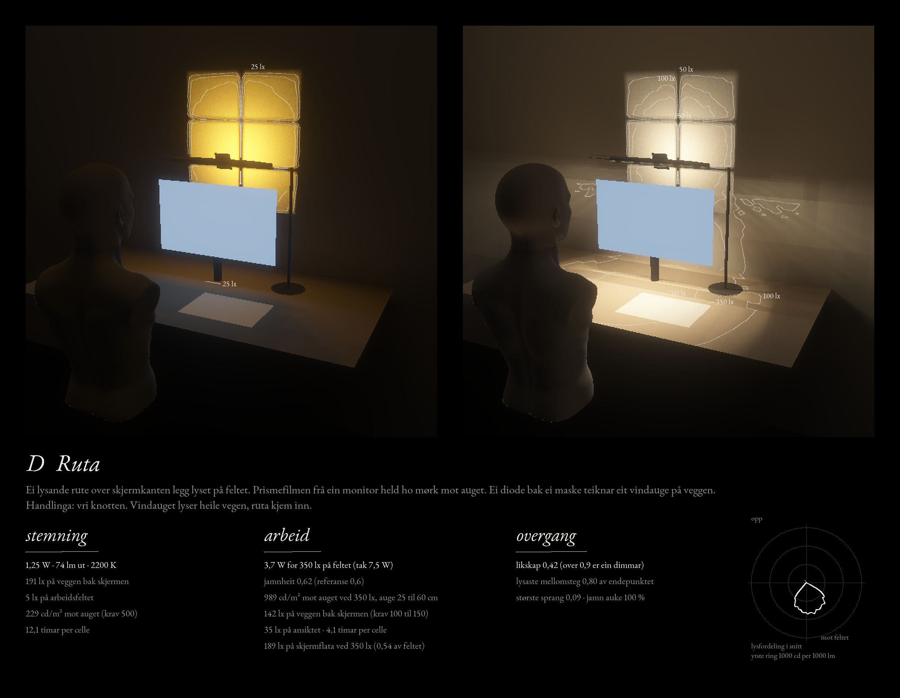
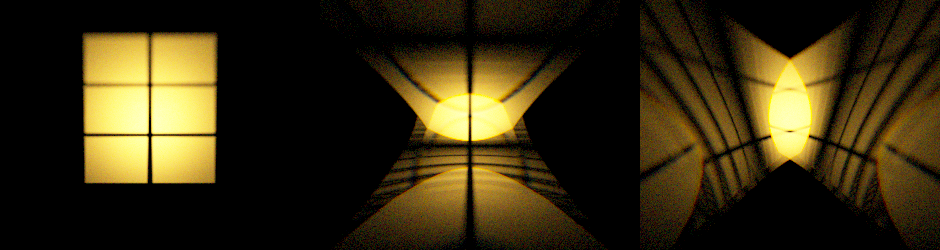

# D Ruta

Dato: 13.11.2026. Ruta er ført fram til same nivå som A, B og C: same rom, same watt, same tal. Alt er modell, ikkje måling. Arket er rekna som ideelt 90°-prisme (ANTAKING). Skriptet er `ruta.py`, tala ligg i `tal-D.json`, arket i `ark-D-ruta.png`.

## Lampa

- **Bjelken** står over skjermkanten, 50 cm over bordet og 5 cm bak skjermplanet, på ei stong bak skjermen.
- **Ruta** går 19 cm framover frå bjelken og er 45 cm brei. Ho er eit flatt, kvitt hus med dioder og ein spreiar, med prismefilmen ytst. Prisma vender ut, rillene peikar mot brukaren, og ruta hallar 10° framover.
- **Vindaugsdioden** sit på baksida av bjelken, 10 mm bak ei maske på 50 × 37 mm. Ho teiknar eit vindauge på 54 × 60 cm på veggen, 18 cm unna. Klippemalen er `klippemal-vindauge.png` (1:1 ved 508 dpi).
- **Handlinga** er ein knott. Vindauget lyser heile vegen (1,25 W i stemning, 20 % av watten i arbeid), og ruta kjem inn frå null. Ingenting flyttar seg.

Første framlegg var ei rute som svinga frå bak skjermen til tak. Svingen går gjennom skjermkanten og er vraka.

## Tala

| | A Skiva | B Over | C Vindauge | D Ruta |
| --- | --- | --- | --- | --- |
| Watt for 350 lx på feltet (tak 7,5) | 2,99 | 3,56 | 5,78 | 3,69 |
| Timar per celle ved 350 lx | 5,1 | 4,2 | 2,6 | 4,1 |
| Jamnheit (referanse 0,6) | 0,62 | 0,41 | 0,62 | 0,62 |
| Mot auget ved 350 lx, 25 / 47 / 60 cm (F5 1500) | 1013 / 103 / 103 | 1124 / 196 / 196 | 155 / 122 / 122 | 1040 / 136 / 136 |
| Veggen bak skjermen ved 350 lx (F6 100 til 150) | 109 | 114 | 127 | 142¹ |
| Skjermflata ved 350 lx (del av feltet) | 115 (0,33) | 60 (0,17) | 39 (0,11) | 188 (0,54) |
| Ansiktet ved 350 lx | 29 | 43 | 25 | 35 |
| Stemning: mot auget, verste augehøgd (krav 500) | 424 | 110 | 76 | 242 |
| Stemning: veggen bak skjermen | 131 | 108 | 72 | 189 |
| Stemning: skjermflata | 105 | 5 | 0 | 1 |
| Likskap stemning og arbeid (over 0,9 er dimmar) | 0,60 | 0,71 | 0,54 | 0,42 |
| Største sprang langs overgangen | 0,08 | 0,12 | 0,05 | 0,10 |

¹ Rekna på 10 cm gitter. For B låg det grove gitteret 15 % for høgt, så talet for D kan vere noko lågare.

## Vindauget på veggen

Venstre: maska åleine. 59 % av lyset frå dioden hamnar i vindauget, mot 7 til 11 % då hovudet stod over skjermhjørnet. Kort kast løyser verknadsgraden. Midten og høgre: same maske med eit stykke film framfor (flatsida mot dioden), med rillene vassrett og loddrett. Filmen slepper 26 til 28 % gjennom og gjer vindauget om til ein figur med ei lysande kjerne og bogar. Tala over gjeld den opne maska.

## Kva som held, og kva som ikkje gjer det

1. **F1, F3, F5, F6 og B3 held samstundes,** med jamnheit 0,62 og ingen rørlege delar.
2. **Filmen gjer jobben i ruta.** Med matt spreiar i staden: 6,6 W og 2000 til 2300 cd/m² mot auget.
3. **Skjermflata får mest lys av dei fire:** 188 lx, 0,54 av feltet. Ruta står rett over skjermen og lyser ned langs han.
4. **Hallinga på ruta er ei avveging.** 10° framover gjev jamnheit 0,62 og 1040 cd/m² mot auget 25 cm over bordet. 5° gjev 0,56 og 348. Rett ned gjev 0,49 og 138, og meir lys på skjermen (267 lx).
5. **Stemninga er sterk.** 189 lx bak skjermen ved 1,25 W er meir enn dei andre. Vindauget toler å dempast til ein tredel.
6. **Handlinga er elektrisk.** A, B og C har ei rørsle (vipp, vipp, skyv). D har ein knott.

## Det som ikkje er rekna

- Kropp, velt, kjøling og stykkliste.
- Spegling av ruta i ein tilta skjerm, og auge til sides for midten.
- Kva arket faktisk er, og kor mykje huset sender attende (her 90 %).
- Mønsteret i sjølve ruta sett forfrå. Bak spreiaren er ho jamt lys.

## Skissemodell

- **Ruta:** ei grunn eske av kvit kapaplate, 45 × 19 × 2 cm, med lykt eller diodestripe inn frå kortsida og bakepapir som spreiar. Filmen ytst: prisma ut, rillene langs dei 19 cm.
- **Vindauget:** maska klipt etter malen, 10 mm framfor lykta, 18 cm frå veggen. Lykta må gjennom eit hol på 1 til 2 mm (svart teip), elles blir sprossene borte: opninga på ei telefonlykt er om lag 5 mm og gjev ein skuggekant på 9 cm.
- **Føreseiing:** sett frå stolen er ruta mørk, og ho blir lys når du bøyer deg ned og ser opp i ho. Vindauget er skarpt nok til at sprossene syner.
