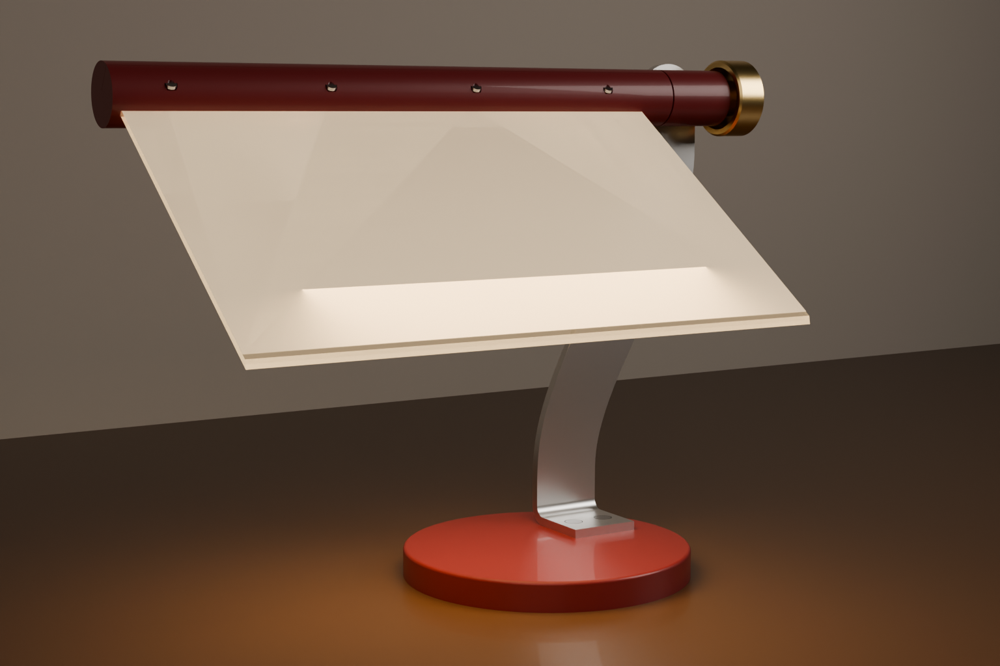

# Ruta på fot: frå skisse til CAD

Dato: 13.11.2026, revisjon A. Lampa på skissa er bygd som parametrisk CAD med samanstilling, printfiler, flate mønster, monteringsark og rendring. Kjelda er `lampe.py`. Alt under `ut/` blir laga på nytt med `python lampe.py`, `python teikning.py` og `blender.exe -b -P render.py`.

Biletet er geometrien frå CAD-en. Gløden i ruta er ei visualisering, ikkje ei lysrekning.

## Status

| Steg | Status |
| --- | --- |
| Form frå skissa til CAD | gjort, med to avvik (sjå under) |
| Digital kontroll: kollisjon, masse, tyngdepunkt, velt, rørsle | gjort. Rørsla er prøvd i steg på 10° frå 0° til 80°, ikkje kontinuerleg |
| Slicer-kontroll | ikkje gjort |
| Fysisk prototyp | ikkje gjort |
| At arket er eit prismeark | ikkje prøvd. Gjer lykteprøva før du kjøper LED-stripa |

## Lampa

- **Foten** er rund, Ø 158 mm (196 cm²), med ei stålplate på 3 mm inni som ballast.
- **Armen** er éi plate av 5 mm aluminium, 40 mm brei, skoren i ein S og bøygd éin gong til ein flik som blir skrudd gjennom foten og inn i ballasten.
- **Bjelken** er Ø 32 mm og 325 mm lang. Inni sit LED-stripa på ei flatstong av aluminium og lyser rett inn i kanten på lysleiarplata. Eit lok klemmer plata og arket med fire skruar.
- **Ruta** er 300 × 190 mm: lysleiar av 3 mm PMMA med prismearket oppå, prisma opp og rillene på tvers av bjelken. Den frie kanten er skoren 45° på oversida og polert. Han speglar lyset som når kanten, ned på bordet.
- **Leddet** er ein M8-bolt gjennom eit leddhus på toppen av armen, med friksjonsskive. Knotten strammar. Ruta kan stå frå flat til 80° helling, med stopp i begge endar.

## To avvik frå skissa

1. **Foten er mindre.** På skissa er foten om lag like brei som bjelken. Kravet F9 er høgst 200 cm² fotavtrykk, og det gjev Ø 158 mm.
2. **Armen svingar 70 mm ut mot høgre.** Det flyttar ruta inn over den vesle foten, slik at tyngdepunktet ligg 9 mm frå midten.

Begge er parametrar øvst i `lampe.py` (`FOT_D`, `ARM_UT`). Med fot på Ø 240 mm toler lampa dobbelt så mykje (15,6 N på venstre hjørne), men ho bryt F9 (452 cm²) og F8 (1378 g).

## Kontrollen

| | Verdi | Krav |
| --- | --- | --- |
| Masse | 1184 g | F8: høgst 1200 g |
| Fotavtrykk | 196 cm² | F9: høgst 200 cm² |
| Tyngdepunkt | 9 mm til høgre og 4 mm bak midten av foten, 151 mm over bordet | |
| Veltevinkel | 24,5° | |
| Trykk ned på venstre hjørne av ruta som veltar lampa | 6,7 N | |
| Trykk ned på fremste kant | 10,7 N | |
| Dytt sidelengs i toppen | 3,1 N | |
| Kollisjonar mellom delar | ingen | |
| Lågaste punkt på ruta ved 80° | 69 mm over bordet | |

Lampa toler lite sidelengs dytt i toppen. Det følgjer av vekt- og fotkravet: 1,2 kg på ein fot med 79 mm radius og 260 mm høgd gjev høgst 3,6 N.

## Lyset

Overslag med same lysmotor som A, B og C (`lys_sjekk.py`). ANTAKING: 60 % av lyset frå stripa kjem inn i plata, og av det går 30 % opp gjennom arket, 60 % ned og 10 % ned ved den skrå kanten. Lampa står til høgre for skjermen.

| | 0,5 W | 2 W |
| --- | --- | --- |
| Bordet under ruta, snitt | 47 lx | 190 lx |
| Bordet under ruta, høgst | 109 lx | 436 lx |
| Feltet framfor skjermen | 14 lx | 57 lx |
| Mot auget, verste augehøgd (krav 500 i stemning, 1500 i arbeid) | 93 cd/m² | 372 cd/m² |
| Ansiktet | 3 lx | 13 lx |

Lampa gjev ein mjuk lyspøl under seg og blendar ikkje. Ho når ikkje 350 lx på feltet framfor skjermen (F3). Ho er eit stemnings- og sidelys.

## Det du må kjøpe

LED-stripe: COB, 5 V, 2700 K, fargeattgjeving minst 90, 8 mm brei, minst 30 cm, med USB-plugg og dimmar på leidningen. Om lag 2 W på 30 cm. Lomma i bjelken tek striper opp til 10 mm breie og 2 mm høge.

## Kontrollmål før noko blir skore

Desse måla kjem frå foto eller er antakingar. Mål med skyvelære og rett parameteren i `lampe.py`.

| Kva | Rekna med | Parameter |
| --- | --- | --- |
| Arket: storleik | om lag 250 × 440 mm. Ruta treng 190 mm langs kortsida og 300 mm langs langsida | `RUTE_B`, `RUTE_D` |
| Arket: tjukn, og kva side som er rifla | 0,25 mm, rillene langs kortsida | `FILM_T` |
| Lysleiarplata frå monitoren: tjukn | 3,0 mm | `RUTE_T` |
| LED-stripa: breidd og høgd | 8 × 2 mm | `LED_B` |
| Flatstonga | 12 × 2 mm | `ALU_B`, `ALU_T` |
| Aluminiumsplata til armen | 5 mm, legering som toler kald bøying (5754 eller 1050, ikkje 6082-T6) | `ARM_T` |
| Stålplata til ballasten | 3 mm | `BALLAST_T` |
| Boltehovud og låsemutter M8 | nøkkelvidd 13 mm | i `_bjelke_lokal` og `knott` |
| Byggjeflata på skrivaren | 256 mm (P1S er ikkje stadfesta) | |

## Filene

| Fil | Innhald |
| --- | --- |
| `ut/ruta-pa-fot.step` | samanstillinga med namn og fargar. Opnast i Fusion, Rhino og SolidWorks |
| `ut/step/` | éi STEP-fil per del |
| `ut/stl/` | printfilene, lagde i printstilling |
| `ut/dxf/` | flate mønster: armen utbreidd med bøyeline, ballasten, lysleiaren, arket, friksjonsskiva |
| `ut/ruta-pa-fot-montering.pdf`, `ut/ark/` | monteringsarka, seks sider |
| `ut/render/ruta-pa-fot.png` | rendringa |
| `ut/kontroll.json` | tala frå kontrollen og stykklista |

## Framstilling

| Nr. | Del | Prototyp | Produksjon |
| --- | --- | --- | --- |
| 01, 02 | fot og botnlok | trykt | trykkstøypt aluminium, pulverlakk |
| 03 | ballast | stålplate 3 mm, skoren, 2 × M5 gjenga | same |
| 04 | arm | aluminium 5 mm, saga eller vasskoren etter DXF, bøygd i skrustikke | laserskoren og kantpressa |
| 06 | leddhus | trykt | maskinert aluminium |
| 07, 08 | bjelke og lok | trykt i to lengder, ståande | ekstrudert aluminium, snittet er likt i heile lengda |
| 09 | lysleiar | plata frå monitoren eller akryl 3 mm, kantane polerte | same |
| 10 | prismeark | frå monitoren | kjøpt på rull |
| 13 | knott | trykt | dreia messing |

Printinnstillingar til å starte med (0,4 mm dyse): 0,20 mm lag, 3 veggar, 15 % gyroid. PETG til bjelken, loket og leddhuset fordi dei ligg ved stripa. Bjelkedelane står på høgkant (186 og 143 mm), så bruk kant. Print prøvedelane `prove_bjelkesnitt` og `prove_loksnitt` først og prøv plata, arket, stripa og flatstonga i dei.

## Armen utbreidd

Lengd 299,6 mm. Bøyelina ligg 40,3 mm frå nedste kant, innvendig radius 6 mm, bøyelengd 12,6 mm (K-faktor 0,4).
