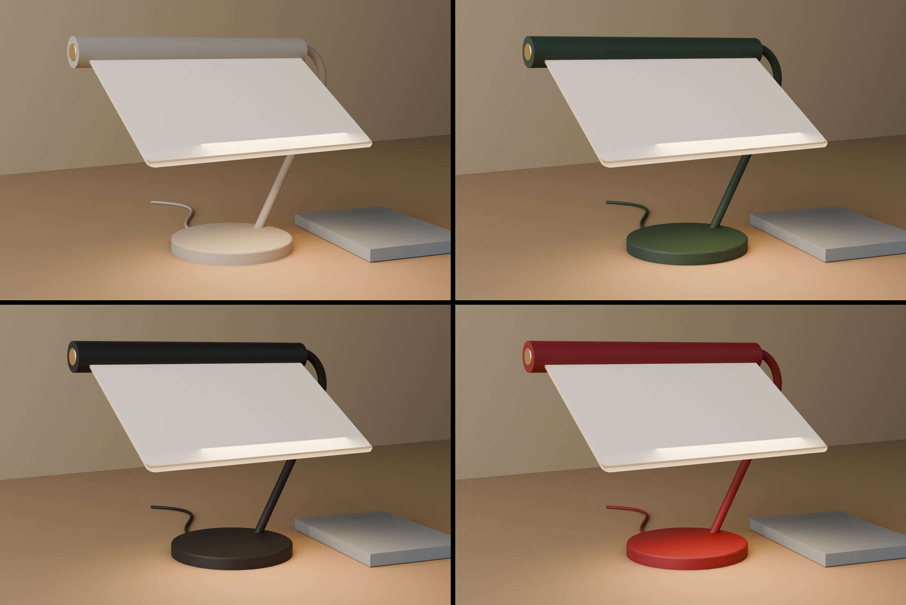

# Ruta på fot, revisjon B: tilpassa formspråket til Northern

Dato: 13.11.2026. Lampa er teikna om etter dei seks trekka som går att i Northern sine lamper. Grunnlaget er granskinga i `research/01-northern.md` frå 12.11.2026 (56 lamper, produktark og produktbilete). Nettsida til Northern svara med «for mange oppslag» i dag, så ingenting nytt er henta derifrå. CAD-en er `northern.py`, alt under `ut-b/` blir laga på nytt med `python northern.py`.

Bileta er geometrien frå CAD-en. Gløden i ruta er ei visualisering, ikkje ei lysrekning.

## Kva Northern-lampene har felles

Frå formspråksanalysen i granskinga:

| | Trekk | Døme hjå Northern |
| --- | --- | --- |
| H1 | To til tre primærformer som møtest utan overgangsform | Snowball (kule, stong, kloss), Balancer mini (kule, søyle), Kin (kuppel, sylinder) |
| H2 | Ei tynn line ber volumet: eitt røyr i éi rørsle, utan synlege ledd i bogen | Salto (lykkje), Buddy (rett vinkel med avrunda hjørne), Me (svanehals) |
| H3 | Lyskjelda er aldri naken | 33 av 56 lamper har opalglas, opal akryl eller tekstil. Fire lyser indirekte |
| H4 | Éin matt farge over heile lekamen, i dempa palett | Svart 57 fargeval, kvit 25, stål 20, messing 17, beige-familien 17, grå 15, mørkegrøn 8 |
| H5 | Éin liten messingdetalj som er både aksent og betjening | Touch-dimmer i messing i enden av armen på Salto, dreiedimmer på foten av Tradition |
| H6 | Éi leiken, fysisk handling som gjev lampa namn | Balancer vippar, Blush bøyer hovudet, Gear har spak |

Næraste slektningar er Archive (2023: liggjande lampe i bøygd stålplate med messingpunkt, 25 eller 50 cm brei og 27 cm høg) og Salto (2022: stålrøyr i éi rørsle med touch-dimmer i messing).

## Revisjon A mot dei seks trekka

| | Revisjon A (frå skissa) | Revisjon B |
| --- | --- | --- |
| H1 | Seks former: fot, platearm, leddhus, bjelke, knott og rute | Tre: skive, røyr og blad (bjelke med rute) |
| H2 | Armen er ei 40 mm brei plate i S-form, skrudd til foten med ein flik | Eitt røyr Ø 12 mm i éi rørsle: skrått opp frå foten, éin boge, vassrett inn gjennom bjelken |
| H3 | Halde: stripa ligg inni bjelken | Halde, same løysing |
| H4 | Tre overflater: raudbrun lakk, børsta aluminium og messing | Éin matt farge på fot, røyr og bjelke |
| H5 | Messingknott Ø 44 mm som strammar leddet. Dimmaren sat på leidningen | Touch-dimmer i messing, Ø 20 mm, i den frie enden av bjelken, som på Salto |
| H6 | Halde: vipp ruta | Halde. Bjelken dreier rett på røyret |

Ruta er brei i høve til høgda (30 mot 26 cm). Det bryt med «lite hovud på lang hals», men følgjer den liggjande typen Northern alt har i Birdy og Archive.

## Kva som er endra i konstruksjonen

- **Røyret er stamme, aksel og kabelveg.** Leddhuset, bolten, knotten, platearmen, fotfliken og kabeldekselet er borte. Bjelken har ei boring bak og dreier på det vassrette løpet av røyret.
- **Ingen synlege skruar.** Loket på bjelken sit på undersida. Røyret er festa i foten med ein settskrue nedanfrå.
- **Mjukare kantar.** Dei frie hjørna på ruta har radius 8 mm, og foten radius 3 mm.
- **Leidningen** går inni røyret og ut bak foten som stoffkledd leidning i same farge.
- **Røyret hallar 30° ut mot høgre.** Det er ikkje pynt: hallinga flyttar ruta inn over foten, slik at tyngdepunktet ligg 6 mm frå midten.

## Tala

| | Revisjon A | Revisjon B | Krav |
| --- | --- | --- | --- |
| Delar (utan lause skruar) | 19 | 12 | |
| Synlege skruar | 6 | 0 | |
| Masse | 1184 g | 1104 g | høgst 1200 g |
| Fotavtrykk | 196 cm² | 196 cm² | høgst 200 cm² |
| Tyngdepunkt frå midten av foten | 10 mm | 6 mm | |
| Trykk ned på venstre hjørne av ruta som veltar lampa | 6,7 N | 7,7 N | |
| Trykk ned på fremste kant | 10,7 N | 12,0 N | |
| Dytt sidelengs i toppen | 3,1 N | 3,0 N | |
| Kollisjonar, helling 0° til 80° i steg på 10° | ingen | ingen | |

## Fargane

Hovudfargen er grå-beige, som dei nyaste Northern-lampene kjem i (Snowball oppladbar, Tradition). Mørkegrøn og svart er dei andre trygge vala i paletten. Kirsebærraud er med fordi skissa var raudbrun: fargen finst éin gong i sortimentet og er ein aksentfarge, ikkje ein hovudfarge.

## Det som er uvisst eller ikkje gjort

- **Bøyen i røyret** er 120° med 45 mm radius på eit stålrøyr Ø 12 × 1,5 mm. Det krev røyrbøyar. Aluminiumsrøyr er lettare å bøye, men då blir lampa 150 g lettare på høgre side og tyngdepunktet flyttar seg mot ruta.
- **Friksjonen mellom bjelke og røyr** er ikkje teikna i detalj og ikkje prøvd. Bjelken treng to klemringar eller ein bremsesko inni.
- **Touch-dimmaren** er ein del til som må kjøpast, saman med LED-stripa. Alternativet er å la dimmaren sitje på leidningen og la messingpunktet vere eit lok.
- **Prototypen** må lakkast eller trykkjast i éin farge for at H4 skal synast.
- **Slicer og fysisk prototyp** er ikkje gjort. Lyset er det same som i revisjon A og er ikkje rekna på nytt.

## Filene

| Fil | Innhald |
| --- | --- |
| `northern.py` | CAD-en for revisjon B. Proporsjonane står øvst |
| `ut-b/ruta-pa-fot-rev-b.step` | samanstillinga |
| `ut-b/stl/` | printfilene og to prøvedelar |
| `ut-b/render/` | rendringane |
| `render_northern.py` | rendrar dei fire fargane i dagslys frå sida |
