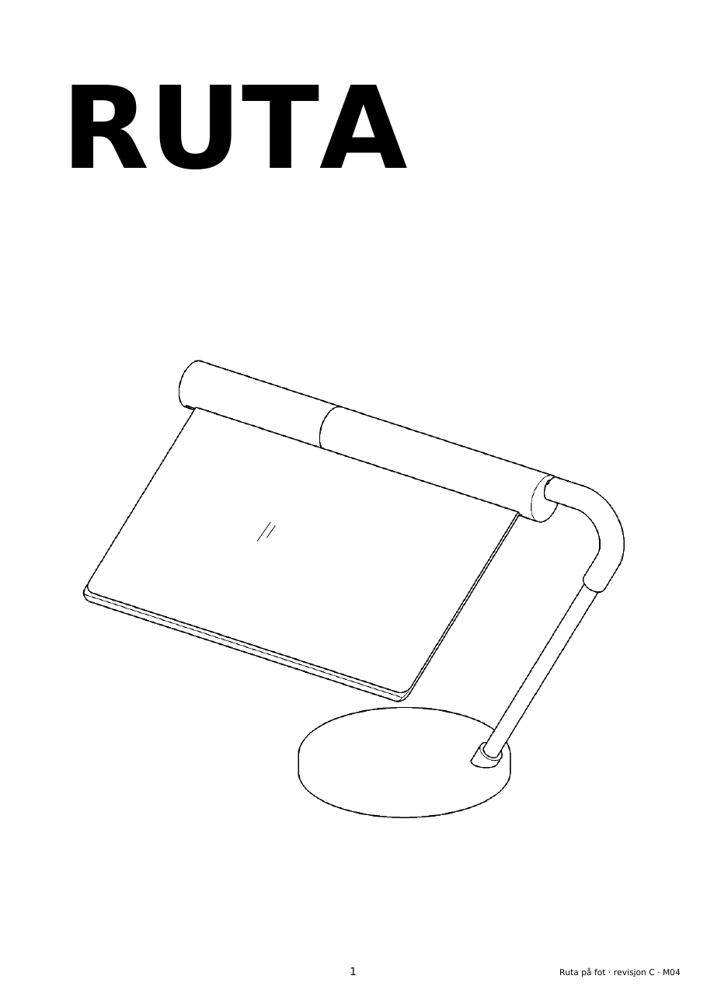

# Ruta på fot, revisjon C: klar for print og butikk

Dato: 14.11.2026. Revisjon B var eit formstudium: eitt bøygd stålrøyr, innpressmutterar og ein brems som ikkje var teikna. Revisjon C er same lampe, teikna slik at ho kan lagast med ein 3D-printar, ei baufil og delar som står i hylla i Oslo sentrum. CAD-en er `ruta_c.py`, alt under `ut-c/` blir laga på nytt med `python ruta_c.py`. Monteringa står i heftet `rettleiing-c/ut/rettleiing.pdf`.

## Kva som er endra frå B, og kvifor

| Revisjon B | Revisjon C | Grunn |
| --- | --- | --- |
| Eitt stålrøyr Ø 12 × 1,5 bøygd 120° | To rette koparrøyr Ø 12 i eit trykt bogestykke (12) med 25 mm muffer | Ingen røyrbøyar. Røyret kan kappast med baufil |
| Innpressmutterar M3 og M4 | Skruane formar gjenga sjølve i trykte hol Ø 2,5, med 8 mm inngrep | Ingen loddebolt, ingen spesialdelar |
| Lokskruar M3 × 12, som ikkje nådde mutterane | M3 × 20 (E) | Feil i B, funnen då C vart teikna |
| Stoppskrue gjennom hol i røyret | Krage på bogestykket som går i ei C-forma lomme i bjelken, og ein låseskrue i eit spor | Ingen boring i røyret. Stoppen ved 0° og 80° sit i plasten |
| Bremsen ikkje teikna | Skrue (G, M3 × 10 kappa til 8 mm) som trykkjer ein trykt sko (13) mot akselrøyret | Friksjonen kan stillast, og skruen gneg ikkje på røyret |
| Rund stålplate Ø 106 × 5, skoren | 33 stålskiver M16 i 11 stablar på pinnar i foten | Skivene finst i pose. Plata måtte ha vore skoren hjå ein verkstad |
| Bjelke og lok i eitt stykke på 328 mm | Begge delte i to, med skøytane forskyvde 66 mm | Printaren tek 256 mm. Loket bind bjelkeskøyten, bjelken bind lokskøyten |
| USB-stripe med touch-dimmar | COB-stripe 24 V, 27 cm, med adapter og brytar på leidningen | Varm kvit USB-stripe og dimmar fanst ikkje i sentrum |
| Settskrue mot røyret i foten | Røyret er limt i ein sokkel med blindboring, med ein trykt fotring (14) rundt | Epoksy tek moment betre enn éin skrue mot tynn røyrvegg. Ringen aukar innfestinga frå 8 til 24 mm og set hellinga på 30° |
| Bjelkehalvdelane møtest butt | To filamentbitar som styrepinnar i skøyten | Halvdelane kan ikkje vri seg mot kvarandre medan limet herdar |

Formtrekka H1 til H6 frå `01-northern-tilpassing.md` står. Bogestykket har same diameter heile vegen og les som ein del av lina. Skruane sit under og bak.

## Tala

| | Revisjon C | Krav |
| --- | --- | --- |
| Masse i CAD | 1103 g | høgst 1200 g |
| Fotavtrykk | 196 cm² | høgst 200 cm² |
| Tyngdepunkt frå midten av foten | 10 mm | |
| Kollisjonar, helling 0° til 80° | ingen | |
| Stopp ved 0° og 80°, låseskruen held | ja | |
| Leidning Ø 4 fri ut av foten | ja | |

Massen er rekna med 55 % fylt PETG i snitt. Med printoppsettet under blir lampa om lag 1150 g. Er skivene 3,0 mm og ikkje 2,7 mm, kjem 37 g til. Det er framleis under kravet.

Kor lite som skal til for å velte lampa, rekna over alle velteretningar:

| Helling på ruta | Trykk ned på venstre hjørne | Trykk ned midt på fremste kant | Dytt sidelengs i toppen | Veltevinkel |
| --- | --- | --- | --- | --- |
| 0° | 3,8 N | 6,4 N | 2,7 N | 24,7° |
| 35° | 4,5 N | 10,0 N | 2,8 N | 28,4° |
| 80° | 6,8 N | | 2,9 N | 30,9° |

3,8 N er om lag 390 gram på hjørnet av ruta. Det er lite, og det følgjer av krava: 1,2 kg og ein fot på 200 cm² under ei rute som stikk 19 cm ut. Tala i `01-northern-tilpassing.md` (7,7 og 12,0 N for revisjon B) er rekna med ein enklare formel som berre såg på éi retning, og er like mykje for høge.

Styrke, rekna med 8 N på hjørnet, det doble av det som veltar lampa:

| Del | Last | Grense | Tryggleik |
| --- | --- | --- | --- |
| Bogestykke, PETG, bøying | 6,2 MPa | 40 MPa | 6,5 |
| Koparrøyr Ø 12 × 1, bøying | 39 MPa | 150 MPa | 3,8 |
| Flatetrykk i muffene i bogestykket | 2,1 MPa | 40 MPa | 19 |
| Kanttrykk der stamma står i foten, med fotring | 2,7 MPa | 40 MPa | 15 |
| Stoppflata ved 1 Nm på ruta | 5,0 MPa | 40 MPa | 8 |
| Gjenga til bremseskruen | 168 N | 647 N | 3,8 |

Utan fotringen ville kanttrykket i foten vore 22 MPa. Bremsa må halde 252 Nmm når ruta ligg flatt, og er rekna for det doble. Skoen kan gå 0,75 mm mot røyret, og 0,25 mm trengst. Akselrøyret bøyer seg 0,34 mm under eigenvekta av ruta.

## Trykte delar

PETG, dyse 0,4 mm, lag 0,2 mm, fire vegger, fem lag topp og botn, 25 % gyroid om ikkje anna står. Filene ligg i `ut-c/stl/` og er lagde i printstilling.

| Fil | Mål i mm | Stilling og oppsett |
| --- | --- | --- |
| `01_fot.stl` | 158 × 158 × 16 | Toppflata ned, utan støtte, fem vegger |
| `02_botnlok.stl` | 145 × 145 × 4 | Den flate undersida ned, utan støtte |
| `05_bjelke_venstre.stl` | 36 × 36 × 131 | Ståande på enden med skøyten opp. Støtte berre i endeloklomma, 5 mm brem |
| `05_bjelke_hogre.stl` | 36 × 36 × 197 | Ståande på enden med skøyten opp. Støtte berre i kragerommet, 5 mm brem |
| `06_lok_venstre.stl` | 194 × 17 × 16 | Klemflata ned, støtte frå plata under leppa |
| `06_lok_hogre.stl` | 118 × 17 × 16 | Klemflata ned, støtte frå plata under leppa |
| `11_endelok.stl` | 20 × 20 × 4 | Flatt |
| `12_bogestykke.stl` | 75 × 80 × 18 | Liggjande, 100 % fyll, støtte berre frå plata, 5 mm brem |
| `13_bremsesko.stl` | 10 × 8 × 3 | 100 % fyll |
| `14_fotring.stl` | 18 × 18 × 17 | Ståande på den rette enden, 100 % fyll |

Alt får plass på 256 mm. Passingane er 0,30 mm der det skal limast og 0,40 mm der noko skal gli. Den avrunda toppkanten på foten ligg mot plata og blir litt ujamn i dei første laga. Slip han før lakk.

### Prøvebitar først

Seks små bitar fortel om passingane held på akkurat denne printaren og dette røyret. Print dei før dei store delane.

| Fil | Prøver |
| --- | --- |
| `prove_muffe.stl` | Røyret skal gå inn med handmakt i det eine holet og gli i det andre. M3 skal forme gjenge i det minste |
| `prove_krage.stl` | Limmuffa slik ho blir trykt i bogestykket, liggjande, med krage og låsespor |
| `prove_krageende.stl` | Kragen frå `prove_krage` skal dreie fritt i enden av bjelken |
| `prove_brems.stl` | Skoen (13) skal gå inn frå sida, og røyret skal skuve han på plass og gli under |
| `prove_bjelkesnitt.stl` og `prove_loksnitt.stl` | Rute og ark skal klemmast når skruen er stramma, utan at bossen sprekk |

Glepp noko, så endre `PASS_LIM`, `PASS_GLID` eller `ROYR_D` øvst i `ruta_c.py` og køyr på nytt.

## Handleliste

Alt er frå Clas Ohlson. Prisane er frå nettsida 14.11.2026. Lagerstatus i kvar butikk er ikkje sjekka.

| Vare | Art.nr. | Pris | Bruk |
| --- | --- | --- | --- |
| Koparrøyr Ø 12 mm × 2 m, forkroma | 30-6571 | 199,90 | 04 (242 mm) og 09 (308 mm) |
| Skruesett M3 med M3 × 10 og M3 × 20 | 40-7042 | 219,90 | 6 E, 3 F, og G som er ein M3 × 10 kappa til 8 mm |
| Skiver M16, Ø 30, 25 stk, to pakkar | 11-1203-16 | 99,80 | 33 skiver som ballast |
| COB LED-stripe 24 V, 3000 K, med adapter og brytar | 36-8960 | 349,90 | 27 cm (ni ledd) i enden med leidningen |
| Loctite Power Epoxy 5 min, 25 ml | 34-8919 | 149,90 | Røyr i muffer og sokkel, fotring, bjelkeskøyten, skivene |
| Wago 221, to leiarar | 36-6520 | 139,90 | Skøyten i foten |
| Antisklknottar Ø 8, 28 stk | 21-2865 | 39,90 | 16 under foten |
| **Sum** | | **1199,20** | |

Til lakk kjem Paintguide grunning 41-3362, Paintguide matt svart 41-3355 eller Vintage Sand 41-3348, og gull metallic 41-3354 til endeloket. Lysleiaren (07) og prismearket (08) kjem frå den gamle skjermen. Akrylplate 300 × 200 × 3 (34-1360, 99,90) er reserve om lysleiaren ryk.

Leidningen på stripa er 1,5 m. Om lag 0,75 m går med inni røyra, så like mykje står att bak foten. Kapp han minst 70 cm frå stripa og på stripesida av brytaren. Rekk han ikkje fram til kontakten, kan ein toleiar på 2 × 0,5 mm² skøytast inn i dei same klemmene.

Verktøy om det manglar: baufil 40-8088, filsett 40-7692, sandpapir 41-3859 og 41-3860, flat trekkjar til M3, vater, skyvelære, ei tynn snor til å dra leidningen med, og nokre centimeter 1,75 mm filament til styrepinnar.

## Lakk

Lampa blir trykt i den fargen som ligg i printaren, og sprøytt i éin matt farge. Det er det H4 krev, og det gøymer laglinene og skøytane.

1. Lim stativet (fot, fotring, stamme, bogestykke, akselrøyr) og bjelken først. Lakk før lys, rute og lok kjem i.
2. Slip plasten lett med korn 240. Slip krommen på stammerøyret matt, elles slepper lakken.
3. Teip det som skal passe: akselrøyret (09), boringa og kragelomma i bjelken, spalta til ruta og LED-kanalen. Lakken byggjer 0,05 til 0,1 mm og et opp klaringa på 0,40 mm.
4. To tynne strok grunning, så to til tre tynne strok farge. Loka (06) blir lakka for seg, med klemflata ned.
5. Endeloket (11) får messingfarge. Det er messingpunktet frå H5.
6. Lat lakken herde eit døgn før montering. Sprøyt ute eller med god lufting, og hald boksen over 15 °C.

Prøv grunning og lakk på ein av prøvebitane først. Heft på PETG er ikkje prøvd.

## Uavhengig kontroll

Tre kontrollørar gjekk gjennom første utkast kvar for seg: montering steg for steg, printbarheit lag for lag, og rekninga på nytt frå STL-volum. Kvart alvorleg funn vart etterprøvd av ein fjerde før det vart rekna som feil. Fire ting ville ha stoppa bygget:

| Funn | Retting |
| --- | --- |
| Leidningen kom ikkje ut av foten. Hakket i veggen var blindt, 2,4 mm gods stod att | Hakket startar 5 mm lenger inne. Kontrollen har fått ein Ø 4-sonde langs leidningsvegen |
| Bremsa klemde ikkje. Skoen tok i skuldra 0,10 mm før han nådde røyret | Vengene på skoen er flytta, så vandringa er 0,75 mm |
| Bjelkehalvdelane stod med skøyten ned og fekk tak i lufta 128 og 184 mm over plata | Dei står no på enden med skøyten opp |
| Botnloket låg opp ned i printfila | Retta |

I tillegg er dette endra etter kontrollen: fotringen, styrepinnane, stripa på 27 cm (leidningen kom ikkje ned i slissa med 30 cm), bremseskruen på 8 mm (hovudet stakk 1 mm ut), tappar og klossar som toler skiver opp til 3,3 mm, avlasting ved loket som klemmer plater ned til 2,25 mm, og velterekninga. Skoen blir no skoven på plass av røyret: i båsen der han går inn, er taket lågare, så røyret må flytte han inn under skruen for å kome forbi, og han kan ikkje gli attende.

## Det som er uvisst eller ikkje gjort

- **Ingenting er trykt eller montert.** Kontrollen er digital: masse, velt, kollisjon, stopp og styrke i `ut-c/kontroll.json`.
- **Røyrveggen** er rekna til om lag 1,0 mm ut frå vekta på pakken. Mål ytterdiameteren med skyvelære før print.
- **Skivene** er rekna til 2,7 mm og 10 g ut frå vekta på pakken. DIN 125 seier 3 mm nominelt. Foten tek skiver opp til 3,3 mm, og skivene blir limte til tappane, så tjukna treng ikkje treffe.
- **Lysleiaren** frå skjermen er føresett å vere 300 × 190 × 3 mm. Loket klemmer plater frå 2,25 til 3,2 mm. Mål plata og arket, og rett `RUTE_T` og `FILM_T` om dei vik av. Plata treng fem hol Ø 4 etter `ut-c/geometri.json`.
- **Bremsa** kviler på ein skruespiss mot 2 mm PETG. Plasten kan sige. Stram G etter eit døgn og etter ei veke.
- **Lyset** er ei 24 V-stripe med brytar, utan dimming. 27 cm gjev om lag 0,6 til 0,8 W etter databladet, og 15 mm i kvar ende av kanten er utan stripe. Lysstyrken i ruta er ikkje rekna eller målt.
- **Slicing** er ikkje gjort. Printoppsettet over er eit framlegg.
- **Heft av lakk og lim** på PETG og på slipt krom er ikkje prøvd.

## Filene

| | |
| --- | --- |
| `ruta_c.py` | Parametrisk CAD, kontroll og eksport |
| `ut-c/stl/` | Printfiler og prøvebitar |
| `ut-c/ruta-pa-fot-rev-c.step`, `ut-c/step/` | Samanstilling og einskilddelar |
| `ut-c/kontroll.json`, `ut-c/geometri.json` | Tal og mål |
| `rettleiing-c/` | Monteringshefte i IKEA-stil, 10 sider (M04) |
