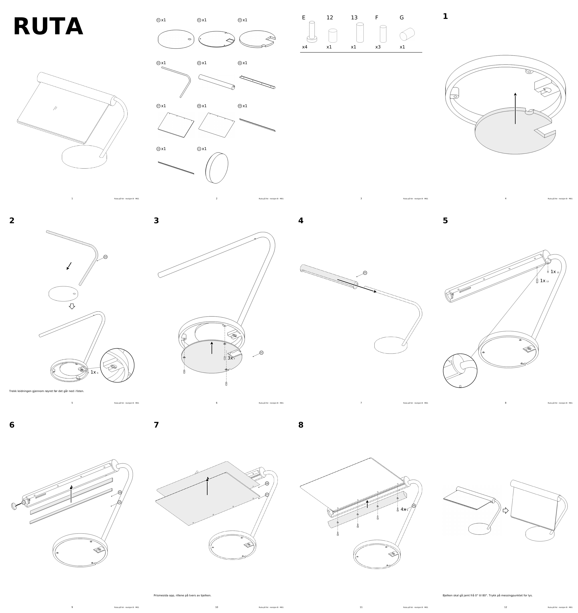

# Monteringsrettleiing for Ruta på fot, revisjon B (M01)



Tolv sider i IKEA-stil, laga med skillen `ikea-rettleiing` og `verktoy/ikea/bygg.py` i [formnerd](https://github.com/lukketsvane/formnerd). PDF-en ligg i `ut/rettleiing.pdf`, sidene i `ut/sider/`.

## Bygg på nytt

```bash
python lag_delar.py                                              # delane i 0°, 35° og 80°
python <formnerd>/verktoy/ikea/bygg.py spesifikasjon.json ut     # PDF, sider, kontaktark og rapport
```

`lag_delar.py` les `../ut-b/samla/*.stl` frå `northern.py` og dreier bjelken med alt som sit i han om røyraksen. Når CAD-en endrar seg: køyr `python ../northern.py` først, så dei to linjene over.

## Rekkjefølgja

| Steg | Handling | Kvifor her |
| --- | --- | --- |
| 1 | Ballast (03) inn i foten (01) nedanfrå | Foten er open under til botnloket kjem på |
| 2 | Røyret (04) ned i hylsa, settskrue G | Leidningen må gjennom røyret først. Settskruen er berre tilgjengeleg før botnloket |
| 3 | Botnlok (02) med 3 F | Lukkar foten |
| 4 | Bjelken (05) inn på det vassrette løpet frå venstre | Boringa er open i høgre ende |
| 5 | Stoppskrue (12) og bremseskrue (13) nedanfrå | Holet til stoppskruen ligg rett over gjengene i røyret berre ved 0° |
| 6 | Flatstong (09) med LED-stripe (10), dimmar (11) | Inn frå undersida medan loket er av |
| 7 | Prismeark (08), så lysleiar (07) | Prismesida opp, rillene på tvers |
| 8 | Lok (06) med 4 E | Klemmer ruta og lukkar bjelken |
| | Kontroll ved 0° og 80° | Same rørsle som kollisjonskontrollen i `northern.py` |

## Antakingar og det som manglar

- **F og G finst ikkje i dellista** i `northern.py`, men hola gjer det: tre hol med forsenking i botnloket mot boss i foten, og settskruen M4 mot røyret som kommentaren i `fot()` nemner. Lengdene er ikkje fastsette.
- **Innpressmutterar** (fire M3 i bjelken, éin M4 til bremseskruen) er rekna som ferdig pressa inn og er ikkje viste.
- **Leidningen** inni røyret og koplinga til LED-stripa og dimmaren er ikkje teikna, berre nemnd i steg 2.
- **Digitalt kontrollert:** `rapport.json` har ingen åtvaringar. Streken er 0,57 til 0,81 pt i ferdig storleik.
- **Ikkje prøvd fysisk:** røyrbøyen, friksjonen i bremseskruen og at stoppskruen kan førast inn gjennom loket ved 0°. Manualen er ikkje prov på at delane passar.

Referansane og grepa som er overførte, står i `ikea-reference-audit.md`.
