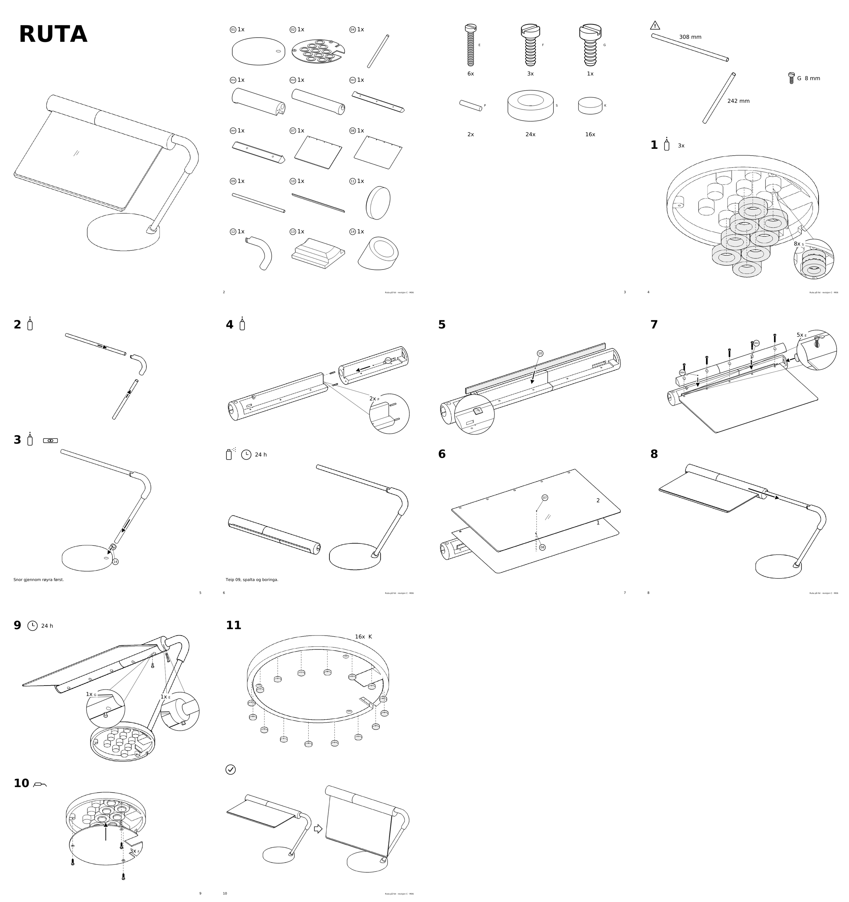

# Monteringsrettleiing for Ruta på fot, revisjon C (M06)



10 sider i IKEA-stil, laga med skillen `ikea-rettleiing` og `verktoy/ikea/bygg.py` i [formnerd](https://github.com/lukketsvane/formnerd). PDF-en ligg i `ut/rettleiing.pdf`, sidene i `ut/sider/`. Handleliste, printoppsett og lakk står i `../02-produksjonsklar.md`.

## Bygg på nytt

```bash
python ../ruta_c.py                                              # CAD, kontroll og ut-c/
python lag_delar.py                                              # delane i 0°, 28°, 35°, 80° og på benken
python lag_spesifikasjon.py                                      # spesifikasjon.json
python <formnerd>/verktoy/ikea/bygg.py spesifikasjon.json ut     # PDF, sider, kontaktark og rapport
```

## Rekkjefølgja

| Steg | Handling | Kvifor her |
| --- | --- | --- |
| | Kapp røyret i 242 og 308 mm, og éin M3 × 12 til 8 mm (G) | Alt anna ventar på røyra |
| 1 | 24 skiver på åtte av tappane i foten (01), limte | Foten ligg opp ned og er open. Limet held skivene til botnloket kjem på |
| 2 | Røyra (04, 09) limte i bogestykket (12) | Muffene styrer vinkelen |
| 3 | Stamma limt i foten, fotringen (14) flatt mot foten, akselrøyret i vater | Ringen set hellinga. Vateret er det einaste som må stillast. Trekkjesnora må inn før limet |
| 4 | Bjelkehalvdelane (05) limte saman på restrøyret, med to filamentpinnar | Røyret held boringa rett, pinnane held vinkelen |
| | Lakk | Før lys og rute. Akselrøyr, boring og spalte er teipa |
| 5 | Bremsesko (13) og LED-stripe (10) | Skoen går inn frå LED-kanalen og må inn før stripa |
| 6 | Prismeark (08), så lysleiar (07) | Bjelken ligg med undersida opp |
| 7 | Lok (06) med 5 E, endelok (11) | Klemmer ruta. Loket bind skøyten i bjelken |
| 8 | Bjelken inn på akselrøyret | Leidningen blir dregen gjennom røyra med snora. Røyret skuvar skoen på plass under skruen |
| 9 | Låseskrue (E) og bremseskrue (G), ved 28° | Låseskruen går i sporet i kragen og held bjelken på røyret |
| 10 | Leidningen lodda til stripa og knytt innanfor veggen, botnlok (02) med 3 F, lampa på ryggen | Knuten er strekkavlasting |
| 11 | 16 knottar (K) | Lampa står på knottane, 75 mm frå midten |
| | Kontroll ved 0° og 80° | Same rørsle som kollisjonskontrollen i `ruta_c.py` |

## Endra frå M05

M06 følgjer budsjettkurven på under 400 kr (sjå `../02-produksjonsklar.md`): 24 skiver på åtte tappar, skruar på 19 og 12 mm, USB-stripe utan klemmer, og loddepiktogram i steg 10. Dei 16 føtene (K) er heimelaga gummibitar.

## Endra frå M04

Tre dommarar samanlikna M04 med kvar sin ekte manual (MOSSJÖN, PAX og SUNNERSTA) og gav 5 til 6 av 10 for heilskapen. Dei var samde om kva som skilde: beslaga var glatte sylindrar, mengdene låg oppå figurane, delballongane peika i lause lufta, streken varierte frå 0,5 til 0,9 pt, og seks setningar stod att. M05 (`samanlikning/ruta-m05-mot-milsbo.png`):

- skruane har gjenger og spor og står med hovudet opp på beslagsida
- mengda står på ringen til detaljbobla, og boblene har kile frå staden
- delballongar berre der to delar kan forvekslast, og ingen grå fyll på store flater
- streken held 0,57 til 0,80 pt gjennom heile heftet
- filamentpinnane er teikna som beslag P, og «1» og «2» viser rekkjefølgja på ark og rute
- to notar står att: snora i steg 3 og teipen ved lakken

M05 er ikkje dømd av panelet. Det som framleis skil frå IKEA: glatte, rette leiarar i staden for snakkebobler, ingen hender, dreiepiler eller feil-rett-par, og skrifta er DejaVu Sans.

## Endra frå M03

M03 vart lagd ved sida av MILSBO, same sidetypar (`samanlikning/ruta-m03-mot-milsbo.png`). Fire ting skilde: streken var jamtjukk og grå, kvart steg stod åleine på ei side med mykje luft, nesten kvar side hadde ei setning, og skruane var så små at dei forsvann. M04 (`samanlikning/ruta-m04-mot-milsbo.png`):

- to steg per side, 10 sider i staden for 18
- omriss 1,5 gonger tjukkare enn indre kantar, og svart strek
- kappemåla står som tal i figuren, og piktogram for lim, vater, lakk og ventetid erstattar setningar
- detaljbobler ved bremseskoen, lokskruen og klemmene
- éi delside i staden for to, og større beslag

Det som står att mot IKEA: fem korte notar (snor, filamentpinnar, teip, rekkjefølgja på ark og rute, etterstramming), rette leiarar til boblene i staden for IKEA sine snakkebobler, og ingen hender eller feil-rett-par.

## Endra frå M02

Rekkjefølgja og delane følgjer rettingane etter den uavhengige kontrollen (sjå `../02-produksjonsklar.md`): fotringen (14) er ny, bremseskruen er eit eige beslag (G), skivene blir limte i steg 1 og stripa er 27 cm.

## Antakingar og det som manglar

- **Leidningen** og trekkjesnora er ikkje teikna. Snora er nemnd i steg 3. Resten står i tabellen over og under «Det heftet ikkje teiknar» i `../02-produksjonsklar.md`.
- **Digitalt kontrollert:** `ut/rapport.json` har ingen åtvaringar, og mengdene i stega stemmer med dellista (6 E, 3 F, 1 G, 2 P, 24 S, 16 K).
- **Ikkje prøvd fysisk:** ingenting er trykt eller montert. Heftet er ikkje prov på at delane passar.

Referansane og grepa som er overførte, står i `ikea-reference-audit.md`.
