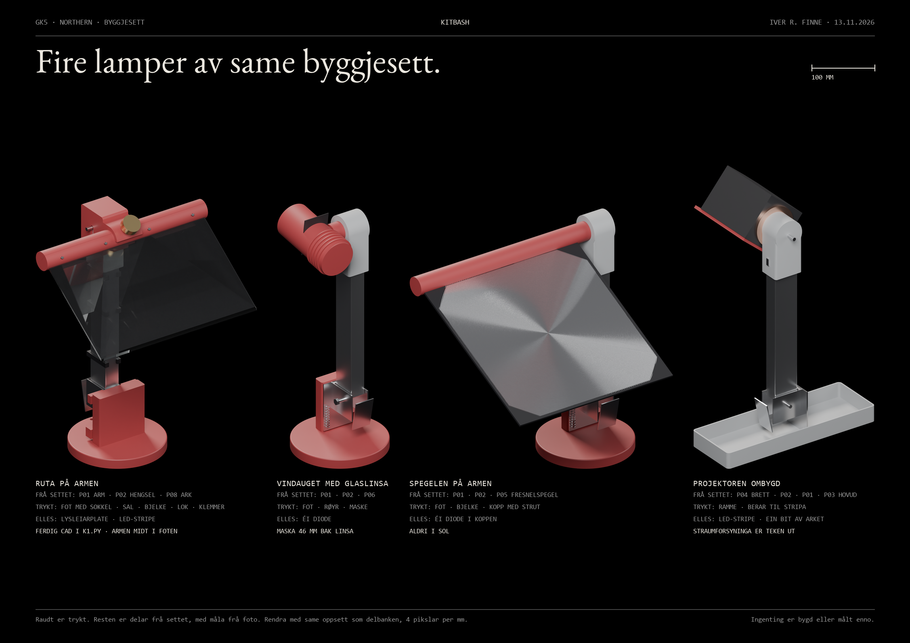

# Kitbash: fire lamper av same byggjesett

Dato: 13.11.2026. Fire lamper sette saman av delane i byggjesettet (`modell/byggjesett/`) og trykte overgangsdelar. Delane frå settet er lesne derifrå og ikkje endra. Rendringa brukar settet sitt eige Blender-oppsett: same Cycles-innstillingar, same lys, ortografisk kamera (asimut −35°, elevasjon 28°), gjennomsiktig bakgrunn og 4 pikslar per mm. Alt står difor i same målestokk som delbanken.

Raudt er trykt. Resten er delar frå settet.

## Stativet som går att

K2 og K3 står på same stativ: ein trykt fot (Ø 158 mm) med ein sokkel, hengselet P02 skrudd mot sokkelen, og armen P01 opp frå hengselet. K1 har same oppbygging, teikna ferdig. Armen kan leggjast ned i hengselet, slik han kunne på projektoren. Dreieaksen i toppen av armen, der hovudet sat, står 384 mm over bordet. Tappen i kappa ber det som er nytt.

## Lampene

| | Frå settet | Trykt | Elles | Kva lampa er |
| --- | --- | --- | --- | --- |
| **K1 Ruta på armen** | P01 arm, P02 hengsel, P08 ark | fot med sokkel, klemmer, sal, bjelke, lok | lysleiarplate, LED-stripe | Lampa du valde, med armen frå projektoren i staden for aluminiumsplata. Teikna ferdig i `k1.py`, sjå `01-k1.md`: armen står midt i foten, og bjelken dreier i ei vogge framfor kappa |
| **K2 Vindauget med glaslinsa** | P01, P02, P06 glaslinse | fot, røyr med kjøleribber, maske | éi diode | Ein liten projektor. Maska står 46 mm bak glaslinsa og blir teikna som eit vindauge på veggen |
| **K3 Spegelen på armen** | P01, P02, P05 fresnelspegel | fot, bjelke, kopp med strut | éi diode | Konsept B med delane frå settet. Dioden sit i ein kopp 12 cm under spegelen og lyser opp i han |
| **K4 Projektoren ombygd** | P04 brett, P02, P01, P03 hovud | ramme, berar til stripa | LED-stripe, ein bit av arket | Projektoren slik han stod, med LED i staden for pæra og arket framfor opninga. Hovudet er dreidd ned mot feltet |

## Det du må vite

- **Måla på delane frå settet er anslag frå foto**, med 3 til 20 mm uvisse. Dei trykte delane her er skisser av overgangane, ikkje ferdig CAD. Mål tappen (Ø 6 × 15 mm), kappa og festeplata på hengselet med skyvelære før noko blir trykt.
- **Brennvidda til glaslinsa er rekna frå forma**, om lag 42 mm, og er uviss (30 til 80 mm). Mål ho ved å teikne eit fjernt vindauge skarpt på eit papir innandørs og måle avstanden frå linsa til papiret. Aldri i sol.
- **K3 står lågare enn konsept B.** B har plata 62 cm over bordet. Armen gjev 38 cm. Tala for B gjeld difor ikkje utan vidare.
- **K4 brukar brettet som fot.** Straumforsyninga (kortet, trafoen, kondensatorane og nettkontakten) må takast heilt ut. Brettet er 285 × 99 mm, altså 282 cm², og bryt fotkravet på 200 cm².
- **Fresnelspegelen og glaslinsa skal aldri liggje i sol**, og pæra frå settet skal ikkje brukast.
- **Ingenting her er lysrekna.** K1 svarar til ruta på fot (om lag 190 lx under ruta ved 2 W). K2 svarar til konsept C og K3 til konsept B, men i andre høgder.

## Filene

| Fil | Innhald |
| --- | --- |
| `kitbash.py` | set saman lampene, teiknar dei trykte delane og skriv `scener.json`. `python kitbash.py ark` lagar arket |
| `render_kitbash.py` | køyrer settet sin rendrar på scenene: `blender.exe -b -P render_kitbash.py` |
| `stl/` | dei trykte delane, på plass i lampa |
| `render/` | éin rendring per lampe, med målestokken i ei json-fil ved sida av |
