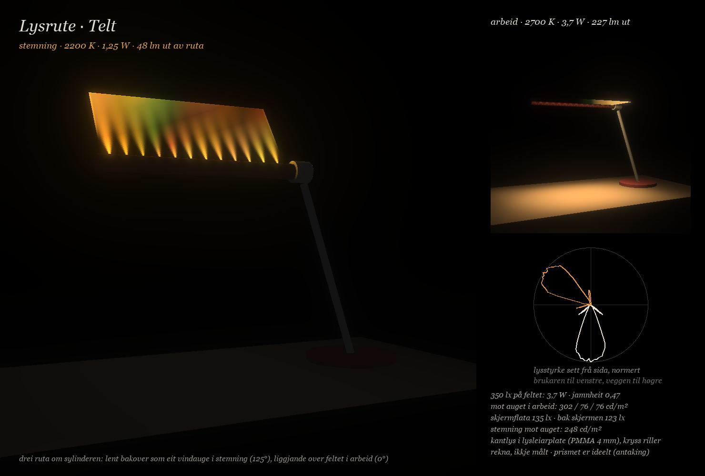

# Lysrute: lampa er vindauget

Dato: 13.11.2026. Ei rute som sjølv lyser, med kantlys i ei lysleiarplate og prismefilm ytst. To kroppar frå dei genererte bileta er rekna i same rom og med same tal som A Skiva, B Over og C Vindauge (`konsept/tre/`). Alt her er **rekna** i modell, ikkje målt, om ikkje anna står. Filmen er det ideelle 90°-prismet frå `konsept/film/film.py` (ANTAKING), fordi `konsept/vindauge/film/arket.md` ikkje fanst då dette vart rekna (sjekka sist kl. 15.50).

Kjeldene er ikkje kopierte inn i repoet:

- Konseptbiletet «Telt»: `C:\Users\Iver\.claude\uploads\6910850b-7461-4c8f-b765-e2447a4a2bf7\50f3c975-image.png`
- Konseptbiletet «Klemme»: `C:\Users\Iver\.claude\uploads\6910850b-7461-4c8f-b765-e2447a4a2bf7\fdc795fb-image.png`
- Foto av filmen mot vindauget: `…\816e4793-image.jpg` og `…\a782f4ce-image.jpg` i same mappe

Filene: `motor.py` (motoren), `studie.py` (lysstudia), `tal.json` (alle tal), `logg.md` (kva som vart prøvd og fall), `scene.json` og `ies_*.ies` (til Blender).

## Dei to kroppane

**Telt.** Ein rund fot i burgunder, Ø 240 × 18 mm, står til høgre for feltet (senter x = 44 cm). Ein arm i børsta aluminium går skrått opp til ein sylinder, Ø 40 × 510 mm, med ein knott på enden. Sylinderen er huset for LED-ane og ligg 50 cm over bordet, 5 cm framfor skjermplanet. Ruta, 480 × 200 × 6 mm, heng frå sylinderen.

- *Gest:* drei ruta om sylinderen. I stemning er ho lent 35° bakover frå loddrett (125°) og er eit vindauge du ser på. I arbeid ligg ho vassrett over feltet og lyser ned.
- *Kvifor 50 cm:* når ruta ligg, må ho gå klar av synslina frå auget til overkanten av skjermen. Den synslina ligg om lag 44 cm over bordet under ruta, så klaringa er om lag 6 cm. Frå 50 cm dekkjer kjegla til filmane (halvverdi 21°) feltet på 60 × 40 cm.
- *Kvifor 480 × 200 mm:* breidda er feltet minus det kjegla legg til på kvar side, og djupna fyller feltet frå skjermen og fram.
- *Kvifor 125° og ikkje ståande:* ståande (90°) lyser rett mot auget, med 973 til 995 cd/m² for auget 47 og 60 cm, og kravet er 500. Ved 110° er det framleis 940 for auget 60 cm. Ved 125° ligg heile augevolumet utanfor kjegla, med høgst 331 cd/m².
- *Kvifor foten står utanfor feltet:* med foten på feltet, slik biletet syner, var jamnheita 0,01, fordi foten skuggar ruta under seg.
- Ei smal diodestripe på baksida av sylinderen, vend mot veggen, tek 25 % av watten. Ho held veggen bak skjermen lys (F6), slik stripa på bjelken i `konsept/film/rute.py` gjer.

**Klemme.** Ei klemme på høgre bordkant (x = 66 cm) ber ein stolpe, Ø 24 mm, opp til 50 cm. Ein arm, Ø 20 mm, går vassrett inn til hovudet. Hovudet, 520 × 200 × 6 mm, dreier om sin eigen lengdeakse, 24 cm inn frå framkanten av bordet og 21 cm framfor skjermen.

- *Gest:* snu hovudet om armen. I stemning vender lysflata mot veggen og taket (−135°). I arbeid lyser ho rett ned.
- *Kvifor via veggen og ikkje via brukaren:* snudd via brukaren vender ruta mot auget midt i gesten. Snudd via veggen er stemninga òg betre: 13 lx bak skjermen mot 2 lx, og 34 cd/m² mot auget.
- Stripa mot veggen fall for Klemme. Hovudet heng framfor skjermen, så stripa lyste på skjermflata (169 lx), og veggen fekk berre 30 lx.

## Lysmotoren

**ANTAKING: lysleiarplata finst ikkje i byggjesettet.** Ho er rekna som dette, frå baksida og ut:

| Lag | Kva | Merknad |
| --- | --- | --- |
| Reflektor | kvit PET, ρ om lag 0,95 | kan hentast frå monitoren |
| Lysleiarplate | klar PMMA, 4 mm, n 1,49 | ANTAKING. Uttak: kvite prikkar eller laga V-riller på baksida, tettare jo lenger frå LED-ane, og reflekterande tape på den frie kanten |
| Kantlys | éi rekkje side-view mid-power LED (3014-typen) med pitch 8 mm i sylinderen: 60 stk 2700 K. Kvar femte plass er 2200 K (pitch 40 mm, 12 stk) | ANTAKING. Arbeid om lag 46 mW per LED, stemning om lag 78 mW |
| Spreiar | volumspreiar | lyset ut av han er rekna lambertsk |
| Prismefilm 1 | rillene vassrett (langs sylinderen) | prismesida ut |
| Prismefilm 2 | rillene loddrett (mot brukaren), øvst | prismesida ut |

Det filmane kastar attende, går ned i huset og kjem att med 90 % (som rho i `rute.py`). Plata kostar i tillegg 0,85 i innkopling og 0,85 i leiing (ANTAKING).

**Verknadsgrad (rekna):**

| Oppsett | Lumen ut per watt (100 lm/W ved LED) | Luminans rett fram mot matt flate med same lumen inn | Halvverdi på tvers / langs |
| --- | --- | --- | --- |
| Plate og spreiar, ingen film | 65 | 0,95 | 90° / 90° |
| Plate, éin film | 64 | 1,85 | 35° / 51° |
| Plate, to filmar i kryss | 52 | 3,3 | 21° / 22° |
| Dioder bak arket (kvitt hus, som `rute.py`), éin film | 89 | 1,85 | 35° / 51° |
| Dioder bak arket, to filmar i kryss | 72 | 3,3 | 21° / 22° |

**Luminansen ut av ruta mot vinkel (rekna).** Telt i arbeid ved 350 lx på feltet, to filmar i kryss, det øvste arket loddrett, cd/m²:

| Vinkel frå normalen | 0° | 10° | 20° | 30° | 40° | 50° | 60° | 70° | 80° |
| --- | --- | --- | --- | --- | --- | --- | --- | --- | --- |
| Mot brukaren (langs rillene i det øvste arket) | 2220 | 2170 | 1600 | 250 | 150 | 930 | 0 | 0 | 0 |
| Til sidene (på tvers av det øvste arket) | 2220 | 2050 | 1160 | 400 | 70 | 80 | 240 | 890 | 1730 |

Cut-off-en held lyset borte frå auget, men berre i éin retning. Éin film har ein sidelobe på tvers av rillene, 0,3 til 0,9 av luminansen rett fram mellom 60 og 80°. Langs rillene er det mørkt frå 60°. Ligg det øvste arket med rillene på tvers av synslina, ser auget 47 cm 1650 til 1950 cd/m² i arbeid (rekna for begge kroppane). Rillene i det øvste arket må difor peike mot brukaren. Sidelobane går då ut til sidene, mot ein som sit ved sida av deg.

**Det auget ser i arbeid:** 301 / 76 / 76 cd/m² (Telt) og 552 / 82 / 74 (Klemme) for auget 25 / 47 / 60 cm over bordet. I augevolumet (±15 cm sidevegs, 15 cm fram, 25 til 60 cm opp) er det høgst 870 og 849 cd/m², begge for auget lågast og nærast. Det er under F5 (1500).

**Lyset på skjermen:** 135 lx (0,39 av feltet) for Telt og 83 lx (0,24) for Klemme. Kjegla til filmane er smal, men ruta ligg over framkanten av skjermen, og halen av kjegla treffer skjermflata. Spegla i skjermen ser auget ingenting når skjermen står loddrett. Tilta 15 til 20° ser auget ruta med 325 til 706 cd/m² (Telt) og 238 til 485 (Klemme). Det gjev 13 til 28 cd/m² slør med blank skjerm (ρ 0,04), og 3 til 7 med matt (ρ 0,01).

**Dioder bak arket i staden for plata:** same fordeling, men 1,4 gonger så mykje lys per watt. Det gjev om lag 2,1 W for Klemme og 2,9 W for Telt (stripa held seg). Prisen er eit hus på om lag 25 mm, dioder som syner som prikkar om spreiaren står for nær, og at ruta ikkje lenger er klar når ho er slått av. Plata er det som gjer ruta til eit vindauge.

## Stripene og regnbogen

Det loddrette, varme mønsteret med regnbogekant på biletet «Telt» kan komme av to ting som begge er fysiske:

1. **Stripene er vifter frå LED-ane i kanten.** I stemning lyser berre kvar femte LED, med 40 mm mellomrom. Kvar LED lyser ei vifte inn i plata, og der vifta er, tek prikkane ut lys. Med nakne LED-ar (±42° i PMMA) flyt viftene saman etter 30 mm (kontrast 0,23, så 0,14 ved 60 mm). Med smal innkopling, 6° i plata, står stripene til om lag 100 mm og løyser seg opp mot den frie kanten (kontrast 0,96 ved 60 mm, 0,5 ved 100 mm, 0,1 ved 150 mm). I arbeid lyser alle 60, og ruta er jamn frå 30 mm (kontrast 0,05). Spreiaren ligg rett på plata, så han viskar ikkje ut stripene, slik han viskar ut dioder som står bak eit ark (jamfør punkt 5 i `konsept/film/01-ruta.md`).
2. **Regnbogen er cut-off-en.** Auget 47 cm ser ruta i stemning 40 til 52° frå normalen, altså på skråninga der kjegla sluttar. Der skil bølgjelengdene lag, fordi cut-off-en flyttar seg om lag 3 til 4° frå 430 til 670 nm. Om lag 60 mm av ruta får synleg farge. Når hovudet flyttar seg 15 cm fram, flyttar bandet seg til 97–166 mm frå sylinderen. Biletet over syner fargen slik han er rekna med sju bølgjelengder, så overgangane er grovare enn dei vil vere.

**Kva auget ser i stemning:** snittet er 73 cd/m². Stripene er 349 cd/m² frå 30 mm, men 926 cd/m² dei første 10 mm frå sylinderen. Kravet 500 held berre om sylinderen dekkjer dei første 30 mm av ruta. Med det er stripene og fargebandet eit grep: dei finst berre i stemning, dei står i ro på ruta og går med blikket, og dei forsvinn når arbeidslyset slår inn.

## Tala

Same rom, same mannekeng og same watt som A, B og C (1,25 W i stemning, 5 W i arbeid, skalert til 350 lx på feltet), rekna med `tre.rekn` frå `konsept/tre/tre.py`. Kopien vart prøvd mot `tal.md`, sjå «Kontroll» under. 2700 K i arbeid og 2200 K i stemning. Watten for Telt inkluderer stripa mot veggen.

| | Telt | Klemme | A Skiva | B Over | C Vindauge | Vindauge utan linse, spjeld (`konsept/film`) | Rute over skjermkanten (`rute.py`) |
| --- | --- | --- | --- | --- | --- | --- | --- |
| Watt for 350 lx på feltet (tak 7,5) | 3,71 | 2,91 | 2,99 | 3,56 | 5,78 | 19,7 (ikkje halde) | 3,66 |
| Timar per celle ved 350 lx | 4,1 | 5,2 | 5,1 | 4,2 | 2,6 | 0,8 | 4,1 |
| Jamnheit (referanse 0,6) | 0,47 | 0,56 | 0,62 | 0,41 | 0,62 | 0,06 | 0,62 |
| Mot auget 25 / 47 / 60 cm, cd/m² (F1 3000, F5 1500) | 301 / 76 / 76 | 552 / 82 / 74 | 1013 / 103 / 103 | 1124 / 196 / 196 | 155 / 122 / 122 | 315 (47 cm) | 1001 / 74 / 74 |
| Augevolum, høgst, cd/m² | 870 | 849 | ikkje rekna | ikkje rekna | ikkje rekna | ikkje rekna | ikkje rekna |
| Veggen bak skjermen, lx (F6 100 til 150) | 123 (121 på 2 cm) | 8 (ikkje halde) | 109 | 114 | 127 | 239 | 147 |
| Skjermflata, lx (del av feltet) | 135 (0,39) | 83 (0,24) | 115 (0,33) | 60 (0,17) | 39 (0,11) | 39 (0,11) | 187 (0,53) |
| Spegling i skjermen tilta 20°, blank / matt, cd/m² | 28 / 7 | 19 / 5 | ikkje rekna | ikkje rekna | ikkje rekna | ikkje rekna | ikkje rekna |
| Stemning: mot auget 25 / 47 / 60 cm (krav 500) | 37 / 248 / 194 | 34 / 34 / 34 | 424 / 100 / 100 | 110 | 76 | 18 | 148 |
| Stemning: veggen bak skjermen, lx | 39 | 13 | 131 | 108 | 72 | 14 | 217 |
| Stemning: feltet / skjermflata, lx | 5 / 11 | 3 / 2 | 9 / 105 | 8 / 5 | 4 / 0 | 1 / ikkje oppgitt | 10 / 1 |
| Likskap stemning og arbeid (over 0,9 er dimmar) | 0,49 | 0,07 | 0,60 | 0,71 | 0,54 | 0,82 | 0,47 |
| Lysaste mellomsteg mot auget / største sprang | **5,82** / 0,26 | 0,66 / 0,43 | 0,71 / 0,08 | 0,48 / 0,12 | 1,03 / 0,05 | ikkje oppgitt / 0,02 | 0,91 / 0,08 |
| Mot auget 47 cm langs overgangen, cd/m² (uskalert) | 248 · 985 · 1445 · 615 · 103 | 34 · 79 · 92 · 67 · 140 | | | | | |
| Skjermflata langs overgangen, lx (uskalert, 1,25 til 5 W) | 11 · 14 · 21 · 51 · 182 | 2 · **53 · 305 · 432** · 143 | 105 · 174 · 220 · 231 · 193 | 5 · 68 · 243 · 243 · 85 | 0 · 3 · 9 · 18 · 34 | | |

## Kva det tyder

1. **Ruta som lampe held arbeidslyset like godt som A og B.** Klemme brukar 2,9 W og Telt 3,7 W med stripa, og begge held F1 og F5 i arbeid. Filmen er det som gjer det: utan film (matt spreiar) treng Telt 6,7 W og blendar med 1884 cd/m².
2. **Rillene i det øvste arket må peike mot brukaren.** Elles går sidelobane rett i auget (1650 til 1950 cd/m²).
3. **Ingen av dei to gestane er rein.** Telt dreier ruta forbi auget og blendar undervegs med 985 og 1445 cd/m² (topp 5,8). Klemme snur hovudet forbi skjermen og legg 305 og 432 lx på skjermflata midt i gesten. Ei rute som dreier om eitt hengsel frå vindauge til tak, passerer anten auget eller skjermen. Det er same funn som for A og B: å flytte strålen sveipar. C deler strålen i staden for å flytte han, og ruta over skjermkanten i `rute.py` heng bak skjermen i stemning (topp 0,91).
4. **Telt har stemninga, Klemme har arbeidslyset.** Telt er eit lysande vindauge i stemning (248 cd/m², stripene og fargebandet) og held veggen bak skjermen i begge tilstandar. Klemme er det beste arbeidslyset (2,9 W, jamnheit 0,56), men stemninga er nesten berre lys i taket (13 lx bak skjermen), og F6 held ikkje i arbeid (8 lx).
5. **Svakheita til Telt er jamnheita (0,47) og skjermflata (0,39).** Ruta ligg rett over framkanten av skjermen.
6. **Ruta over skjermkanten i `rute.py` er sterkare enn begge** på jamnheit og gest, men legg mest lys på skjermflata (0,53). Telt er same grepet flytt 10 cm fram og med eit vindauge du ser på i stemning i staden for eit på veggen.

## Kontroll

- **Filmen** (`film.py` mot `00-vindauge-utan-linse.md`): prisma rett på gjev ±30,8° og 0,47 i kvar lobe, T 0,93. Flatsida rett på gjev T 0. Flatsida 30° gjev −0,8° og 0,63. 450 og 650 nm gjev 31,75° og 30,25°. Alt stemmer med tala der.
- **Mot `rute.py`** (anna økt, same fysikk): éin film gjev same fordeling innanfor støyen (590 mot 589 cd per 1000 lm rett fram, verknad 0,89 mot 0,89). Lampa «over» frå `rute-tal.json`, rekna med Rute-klassen her, gav 10,73 mot 10,71 W, jamnheit 0,03 mot 0,03, 113 mot 112 lx bak skjermen og 653 mot 663 cd/m² mot auget 47 cm.
- **`tre.rekn` mot `tal.md`:** `tre.rekn('A')` køyrd herfrå gav 2,99 W (2,99), jamnheit 0,62 (0,62), 1013 / 103 cd/m² (1013 / 103), 108 lx bak skjermen (109), 115 lx på skjermflata (115), 424 cd/m² i stemning (424), 131 lx bak skjermen i stemning (131) og likskap 0,60 (0,60). Kopien held. Tala for Telt og Klemme er rekna med same `tre.rekn`.

## Kvar motoren skil seg frå rute.py, og kvifor

| | `rute.py` | `motor.py` her | Kvifor |
| --- | --- | --- | --- |
| Kjelde | dioder i eit kvitt hus | kantlys i lysleiarplate (ANTAKING), eller dioder bak arket som i `rute.py` | biletet syner ei klar rute utan hus. Plata kostar 0,72 (innkopling og leiing) |
| To filmar i kryss | lyset frå det øvste arket går rett attende i huset | lyset går mellom arka til det kjem ut eller går i huset | verknad 0,71 mot 0,68. Det er òg det øvste arket som avgjer kvar sidelobane går |
| Retningstabell | 3° breidd og lengd, éi bølgjelengd (550 nm) | retningscosinus 81 × 81, sju bølgjelengder (430 til 670 nm) | fargebandet ved cut-off-en treng bølgjelengdene. Retningscosinus gjev luminansen direkte |
| Auget nær flata | luminans = I / (A · maks(cos, 0,05)) | luminans rett frå tabellen | auget 25 cm i «over» får 6 600 mot 13 500 cd/m². Begge er grove ved 80 til 88° frå normalen |
| Kroppane | funksjonar per lampe | spesifikasjonar: støtte, ruter, rille, kjelde, bak, stripe | neste generasjon kan leggje til kroppar utan ny kode |
| Ekstra tal | | augevolum, spegling i skjerm tilta 0 til 20°, veggen bak skjermen på 2 cm, stripene | krava frå granskinga i `northern-lampe/konsept.md` |

## Frå monitoren

Arket kom frå ein monitor med kantlys. Same monitor har truleg heile lysmotoren som er rekna her. Ta vare på alt:

- **Lysleiarplata** (PMMA eller MS, 2 til 4 mm). Mål tjukna. Fotografer henne mot lys for å sjå prikkmønsteret og korleis det tettnar vekk frå LED-kanten.
- **LED-lista langs kanten.** Tel LED-ane og mål pitchen. Lista er truleg 6500 K og må bytast for 2700 og 2200 K, men lengda, pitchen og aluminiumsprofilen kan brukast.
- **Spreiaren** og **den andre prismefilmen**, som truleg låg i kryss med den du har. Merk kva veg rillene gjekk, og kva side som vende opp.
- **DBEF** eller anna reflekterande polarisator øvst. Han gjev ikkje meir lys til ei lampe, men lyset blir polarisert. Det kan prøvast mot gjenskin i skjermen, men det er ikkje rekna.
- **Den kvite reflektoren** bak plata.

Mål dette først: kjegla til eitt og to ark (lykta 30 cm bak spreiaren og arket, eit kvitt kort framfor, mål kvar flekken fell til halvparten), sidelobane ved 60 til 80° på tvers av rillene, og verknadsgraden med ein luxmålar-app, med og utan ark.

## Uvisse

- **Arket er ikkje målt.** Alle tal kviler på eit ideelt 90°-prisme. Fotoa syner samanhengande striper, så prisma kan vere avrunda. Det gjer cut-off-en mjukare, sidelobane svakare og fargebandet breiare.
- **Lysleiarplata er ANTAKING:** innkopling 0,85, leiing 0,85, jamt uttak over heile ruta og ein spreiar som gjev lambertsk lys. Er plata betre eller dårlegare, flyttar watten seg like mykje.
- **Huset sender 90 % attende** (som `rute.py`). Ved 70 % er verknaden 0,74 for éin film, og gevinsten rett fram 1,6. For to ark i kryss fell verknaden til om lag 0,45.
- **Stripemodellen er 2D** og ser bort frå at uttaket tømmer plata. Vifta på 6° er ANTAKING.
- **Mekanikk er ikkje rekna:** sveipet til ruta forbi skjermkanten, momentet i hengslet og om foten held Telt ståande med ruta lent fram.
- **Gesten er rekna med same watt-kurve som A, B og C** (1,25 W til 5 W). Ein gest som held watten låg til ruta har passert auget, ville ta ned toppen for Telt, men ruta ståande gjev om lag 700 til 1000 cd/m² sjølv ved 1,25 W.
