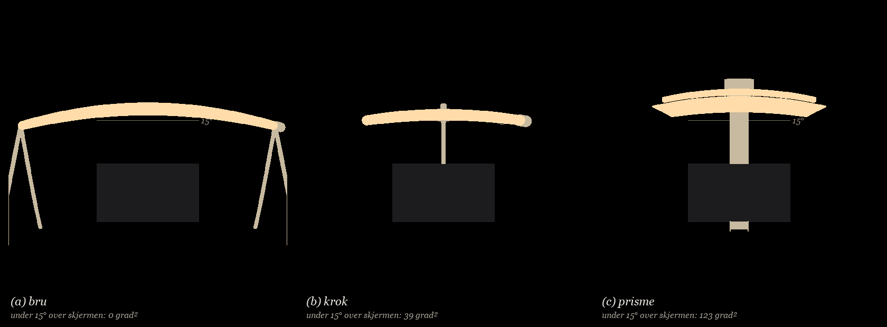

# Gransking · premissar, påstandar, bilete og brief

**Kort.** Talpåstandane held stort sett: 27 av 34 kontrollerte tal stemmer med datafilene (andre pass la til tre avvik mot GK5-dokumenta), og min eigen lysmodell attgjev Φ, U0 og skjermlys for alle tre til om lag 1 %. Feila ligg i premissane. (1) Heile energi- og skjermfordelen til (c) er optikken, ikkje forma: med same vifte i opninga treng (a) 397 lm og lyser 4 lx på skjermen, mot 433 lm og 8 lx for (c). (c) med den nakne opninga til (a) treng 1660 lm og lyser 549 lx. Berre (c) fekk optikk. (2) Søyla i (c) står rett over skjermen: 123 grad² av lampa ligg under 15° over skjermen, mot 39 for (b) og 0 for (a). Premissen som (b) vart trekt for, er broten meir av (c), og det står ikkje i konsept.md. (3) Stemningsstillinga −105° i (c) er umogleg: plata går i armen frå −51°. Der lyser veggen 20 lx, ikkje 40. (4) Svikta i tabellen er tre ulike lastfall. Med gesten i enden av plata vrir den opne U-profilen (c) 5,5 til 13 mm, ikkje 0,2. (5) Premissane i felles.py er ikkje dei i kravspesifikasjonen i GK5-modul_2 (350 lx åleine, augehøgd 25 til 60 cm, høgst 1,2 kg, 100 til 150 lx bak skjermen). Mot den spesifikasjonen fell (c) på vekt (3,11 kg mot 1,2) og lys bak skjermen (0 lx), og (a) og (b) fell på effekt (12,6 og 13,1 W mot 7,5) og blending frå lågt auge. (6) Miljøtiltaket «ein tredjedel av energien» er ikkje robust: straumsparinga mot (a) over 10 år er 1,1 kg CO2e med norsk straum og 11,5 kg med 0,152 kg/kWh, medan 1,26 kg meir aluminium og 0,46 kg PMMA kostar 5,3 til 22,9 kg. (7) Konsepta er ikkje prøvde mot formføringsplansja som no ligg i GK5-modul_2 (side 8 og 9, 11:35). Alle tre er 65 til 76 cm høge mot 27 til 55 cm i sortimentet. (c) bryt tre av reglane direkte: fasettar (rillene), klar i staden for opalkvit lysflate og fleire enn tre primærformer. (8) «Ansiktslys: berre (c)» kviler på premissen 150 lx. Kravet F10 er 50 til 200 lx og «ingen kamerastriper». Ved 50 lx treng (a) og (b) 1,4 og 1,9 kcd/m², under grensa 3000, og prismeplata i (c) lagar striper. (9) Effekt og batteritid er rekna med 100 lm/W og 21,6 Wh. Med reknetala i GK5-modul_2 (80 lm/W, 15,1 Wh brukbart) er (c) 5,4 W og 2,8 t, og (a) og (b) 15,7 og 16,4 W og under 1 t.

Skript: `premiss.py` (om lag 10 til 20 s, éin tråd, køyrd om att 13.11 i andre pass med identisk utdata) og `premiss_tillegg.py` (aritmetikk for 7 til 9 og rettinga i 2.6, under 1 s). Tal: `premiss.json`, `premiss.log`, `premiss_tillegg.json`. Figur: `premiss.png` (lampa sett frå auga, med skjermen og 15°-lina). Eldre, halvferdig versjon av same linse: `premiss_prisme.py/json` (M0 til M3); resultata der er tekne med under 2.1 og stemmer med `prisme.md`.

## Metode og kontroll av eigen kode

Eigen kode, ingen import av `felles.py`, motorane eller `val.py`. Datafilene (json, csv) er berre lesne. Lysmodellen er ei lineær kjelde i fjernfelt med 80 element, I = η·G(θ)·(2/π)·cos ξ per LED-lm, skjermen som hinder, same 7 × 5-, 8 × 6- og 8 × 5-gitter som felles.py. G(θ) for opninga i (a) og (b) er lambertsk om normalen ψ. Vifta til (c) er utleidd på nytt frå 2D-fluksbevaring (J ∝ 1/cos²θ mellom kantane av sona, y 0,02 til 0,43), med 4° gauss. Synsfeltet er sampla overflatepunkt på kvar del, projisert til (asimut, elevasjon) frå auga i 0,1°-celler, med skjermen som hinder.

| Kontroll | Motor / konsept.json | Min kode | Avvik |
|---|---|---|---|
| (a) Φ · U0 · skjerm | 1255 lm · 0,757 · 611 lx | 1245 · 0,753 · 615 | −0,8 % · −0,004 · +0,7 % |
| (b) Φ · U0 · skjerm | 1311 · 0,673 · 652 | 1310 · 0,672 · 653 | −0,1 % |
| (c) Φ · U0 · skjerm | 433 · 0,688 · 8,8 | 432,6 · 0,689 · 7,7 | 0,0 % · 0 · −1 lx |
| stemning 8 × 6 (25 %) | 62 · 69 · 40 lx | 60 · 68 · 40 lx | −1 til −3 % |
| (c) tipp utan skjerm (handrekna frå motor-delane) | 22,1° | tyngdepunkt y 0,400, z 0,289, framkant 0,118 m → 22,1° | 0 |

Lysmodellen i felles.py og form04/motor.py er altså brukt rett. Skilnadene under kjem frå premissane.

## 1 · Talpåstandar mot datafilene

**Avvik:**

| Fil | Påstand | Datafil | Rett tal |
|---|---|---|---|
| form04/logg.md | «Trefjerdedelar mindre lys enn (a) og (b)» | konsept.json Φ 433 / 1255 / 1311 | 66 og 67 % mindre, altså to tredjedelar. konsept.md («ein tredjedel av lyset») er rett |
| form02/val.md | (a) → (c gamal): «1,4 cm² mindre kjølekrav» | form02/tal.json A_krav 418,4 og 351,3 cm² | 67 cm² (16 %) |
| form02/val.md | flat platearm «1,7 mm ved spissen» | tal.json plate_w_spiss_mm 2,71 | 2,7 mm |
| form02/val.md | (a) → (b) «4 % meir lys» | 1311 / 1255 | 4,5 % (avrunda ned) |
| form02/val.md | armen i (b) «syner 6° over augehøgd» | arm_elev_min 6,2° er rekna utan stigaren ved y 0,74 | stigaren syner frå skjermkanten (−2,3°) til 5,9°. Talet 6° gjeld bogen |
| form01/logg.md | kjøl/krav «1433/492 cm²» | form01/tal.csv A_krav 433 | 433. 492 er kravet ved 1476 lm, før endeskivene (1476/100/300 m² = 492 cm²): eit attgløymt tal |
| konsept.md | «Alle tre er rekna … med same tal()» | form04/motor.py har eigen sok(), E_punkt() og L_mot() | (c) brukar tal_felles(), men lys, blending og ansikt er rekna på nytt i motoren: fjernfelt frå LED-aksen, blending med terskel 300 cd/m² og snittluminans. (a) og (b) brukar flatebitane i felles.illum() og visible(). Det er ikkje same målereiskap |
| konsept.md, tabellraden «svikt under gesten» | form01 tal(): 10 N dytt i x på apex; val.py tube_arm(): 3 N i spissen; form04 tal_mek(): 2,5 N midt på framkanten | tre lastfall, sjå 2.4. For (a) er svikta under gesten (kraftpar) om lag 0 |
| form04/motor.py FINAL | «robust punkt» | form04/sok.json | stemmer at punktet held, men det minste Φ som held er ys 0,18, zs 0,66: 415 lm (−4 %). Valet er ikkje grunngjeve med tal |
| konsept.md | batteri (b) «1,5 t» | 0,9·21,6/13,11 = 1,48 t | 1,48 t, altså under kan-kravet T5 (1,5 t) før rundinga |
| konsept.md | «2200 K i stemning» | GK5 04-kravspesifikasjon F11: 2700 mot 2000 K; formføringsplansja: 2200 til 3000 K | dei to GK5-dokumenta er usamde; konsept.md følgjer plansja, ikkje F11 |
| konsept.md | «inga blending over 3000 cd/m²» | form04/motor.py sok(): synleg ved 300 cd/m², glare_ok ved 3000; ramma 00: under 1000 til 1500 i arbeid | grensa i formsøket er to til tre gonger ramma |

**Stadfesta (kort):** batteri 1,5 / 1,5 / 4,5 t (0,9·21,6 Wh/P), (c) tipp 22° utan skjerm (tal.csv tipp_deg 26,6° er med skjerm 4 kg), (a) tipp ved 2,96 N, tett gitter for (a) Φ −4,6 % og U0 0,72, skjermlys 611 / 652 / 8,8 lx, (b) Ø23 2,34 mm og Ø25 1,79 mm ut av planet, klemme 498 N (996 N med SF 2), (a) → (b) 0,24 kg lettare, (a) → (c gamal) −16 % lys, form01 fotavtrykk 0,46 m², form04 6 av 20 punkt, akse 33 mm under LED, innfall høgst 30,6°, pendel 0,224 N·m og 5,3 N. Alle tal i form01/utfall.md stemmer med utfall.json og utfall2.json (H1 −13,5 %, −27 / +30 %; H2 3 til 10 %; H3 9,7 og 31; H4 Ø 8,97 mm og +0,40 kg; H5 U0 0,51 ved 0,30 m og +7,2 % frå 0,75 til 1,00 m; H6 0,24 mm, 2,93 ×, +0,21 kg; H7 15 steg, 0,35 til 0,88; H8 +3,2 %).

## 2 · Sjølvlagde premissar som styrer resultatet

| # | Premiss | Kvar | Kva kviler på han | Likt for alle? |
|---|---|---|---|---|
| 1 | Optikk berre i (c). (a) og (b) er ei naken lambertsk opning | form01/motor.py opning(), form04 optikk() | heile Φ-, effekt-, batteri- og skjermskilnaden (sjå 2.1) | nei |
| 2 | η: hulromsformel for røyret (0,674), stråle-Fresnel × RISS 0,95 for plata (0,739) | eta() i begge motorane | 9 % av Φ-forholdet 2,90 (0,739/0,674 = 1,096). Begge er optimistiske: røyr med LED på veggen 0,56 (fotometri.md), plate i vifta 0,63 (prisme.md) | nei, men lite utslag |
| 3 | Stemning = 25 % av arbeidsfluksen, R_stem ≥ 0,5 | felles.py DIM_STEM, sok() | stemningsraden (62 / 69 / 40 lx). Effektiv optikk gjev svak stemning | formelt likt, verkar ulikt |
| 4 | Synsfelt ≥ 15° berre for lyskroppen, i 2D (utan x), for (c) berre i arbeid | form01 kollisjon(), form04 kollisjon() | plasseringa av alle tre; (b) vart trekt for armen, (c) ikkje for søyla | nei |
| 5 | Svikt: tre ulike lastfall | form01 tal(), val.py tube_arm(), form04 tal_mek() | svikt-raden og «stødig overhead-arm» | nei |
| 6 | 500 lx frå lampa åleine på 0,60 × 0,35 m | felles.py E_TASK, TASK | alle Φ, W og batteritider (× 1,43 mot krav F3: 350 lx åleine) | likt; endrar ikkje rangering, men krava om W |
| 7 | Eitt augepunkt i høgd 0,45 m, tre i x | felles.py EYES | «skjerma» for (a) og (b): opninga syner under 42,4 og 39,9 cm (krav F1: 25 til 60 cm) | likt; rammar (a) og (b) |
| 8 | 100 lm/W, 21,6 Wh, 0,9 | felles.py LM_W, BATT_WH | W og batteri. GK5 reknar 60 til 80 lm/W for heile lampa (02-bransjeresearch l.144) og 17,8 Wh nominelt, 15,1 brukbart (08). Ved 80 lm/W og 15,1 Wh: (a) 15,7 W og 0,96 t, (b) 16,4 W og 0,92 t, (c) 5,4 W og 2,8 t (`premiss_tillegg.json`). Førre versjon av denne fila skreiv «(c) 3,6 t»: det var 80 lm/W med 21,6 Wh, ikkje 17,8 | likt; rangeringa står, men (a) og (b) fell på T5 og langt over ramma 10 W |
| 16 | Ansiktslys 150 lx | felles.py E_FACE l.31 | «for hardt» for (a) og (b), «mjukt, berre (c)». Kravet F10 er 50 til 200 lx. Luminansen er lineær i E: ved 50 lx (a) 1358, (b) 1861, (c) 220 cd/m² i snitt (topp 1070 til 1330, prisme.md). Alle tre under 3000; ved 100 lx held (a) (2717), ikkje (b) (3722) | likt, men avgjer raden |
| 17 | Augepunkt i 45 cm | felles.py EYES | formføringsplansja (side 9) seier «inga lyskjelde synleg frå 47 cm», F1 seier 25 til 60 cm. Tre ulike tal i same prosjekt | likt |
| 9 | Skjermen er ei plate y 0,45 med hals 3 cm bak; søyla i (c) står 1,2 cm bak halsen | lysstudie.py, form04 COL_Y 0,512 | at (c) får plass i det heile; ein vanleg skjermfot står 5 til 15 cm bak plata | rammar berre (c) |
| 10 | Fotavtrykk = konveks skrog av kontaktpunkta | felles.py stabilitet() | «på bordet» 3456 / 40 / 720 cm². (a) tek 13 cm² kontakt, (c) dekkjer 283 cm² av oppgåvesona (x ±0,12, y 0,282 til 0,40) | nei, ulik tyding |
| 11 | Foten i (c) er dimensjonert for F_tipp ≥ 2·F_gest utan skjerm, i arbeidsstillinga | form04 fot_t() | 7 mm alu, 1,36 kg av 3,11. mekanikk_tal.json: tryggleik 1,91 ved α −90° | berre (c) |
| 12 | Strølys 1 % og RISS 0,95 | form04 STRO, RISS | «11 cd/m² mot auga» og «ingenting utanfor vifta» (prisme.md: 300 i snitt, 2600 til 3100 i topp) | berre (c) |
| 13 | Ansiktslys som snittluminans | form04 sok() L150 | «mjukt, berre (c)» (prisme.md: topp 3100 til 4000 cd/m²) | (a)/(b) er jamne i modellen, (c) ikkje |
| 14 | Søk: (a) 48 kombinasjonar, (b) ingen (plassen til form01), (c) 20 punkt | val.py tal_bru(), B_KROK, form04 search() | (b) kan vere 4 til 5 % for høg (val.md seier det sjølv) | nei |
| 15 | 2700 K / 2200 K og dimming 100 → 25 % følgjer vinkelen | konsept.md | «naturleg overgang». Krev to LED-kanalar og ein vinkelsensor; ingen konsept har det | likt, men ikkje løyst |

### 2.1 Optikken: forma eller lysmodulen?

Same lysmodell, same oppgåvesone, berre plassering og G(θ) bytt (`premiss.json` L):

| Variant | η | Φ (lm) | U0 | skjerm snitt (maks) lx | vegg bak skjermen lx |
|---|---|---|---|---|---|
| (a) bru, naken opning (som konseptet) | 0,674 | 1245 | 0,75 | 615 (1141) | 220 |
| (a) bru, vifte i opninga | 0,739 | **397** | 0,67 | **3,7** (26) | 0 |
| (a) bru, vifte, η hulrom × plate 0,674·0,85 | 0,573 | 512 | 0,67 | 3,7 (26) | 0 |
| (b) krok, naken opning (som konseptet) | 0,667 | 1310 | 0,67 | 653 (1406) | 318 |
| (b) krok, vifte | 0,739 | **399** | 0,68 | **5,1** (29) | 0 |
| (c) prisme (som konseptet) | 0,739 | 433 | 0,69 | 7,7 (36) | 0 |
| (c) prisme, naken opning, beste skjerma ψ −26° | 0,674 | **1660** | 0,73 | **549** (1138) | 452 |

Φa/Φc = 2,90. Med same optikk er forholdet 0,92: bru-forma er 8 % *betre* enn prisme-forma. Heile fordelen til (c) i lys, effekt, batteri og skjermlys er lysmodulen, og ein lineær vifteoptikk (prismeplate eller lineær TIR-linse) kan setjast i alle tre. konsept.md skriv «lyset går dit det trengst» som om det var forma. Det er ein eigenskap ved éin komponent som berre (c) fekk.

Prisme-sporinga i `premiss_prisme.json` og `prisme.md` (verkelege riller, 3D) gjev (c) 452 til 482 lm og U0 0,38 til 0,53. Same tap ville ramme ei vifte i (a) og (b). Konklusjonen over står.

### 2.2 Stemningsregelen og stillinga −105°

| | (a) | (b) | (c) ved −105° | (c) ved −60° | (c) ved −50° |
|---|---|---|---|---|---|
| 25 %-regel: LED-lm | 311 | 327 | 108 | 108 | 108 |
| Ē vegg 8 × 6 / fint 2,5 cm (lx) | 60 / 72 | 68 / 86 | 40 / 43 | 35 / 41 | **20** / 34 |
| 10 cd/m² på veggen (ρ 0,75): lm · W | 181 · 1,81 | 160 · 1,60 | 106 · 1,06 | 110 · 1,10 | 135 · 1,35 |

- Med fast veggluminans snur raden: (c) treng minst (stadfestar fotometri.md). Med 25 %-regelen ligg (a) og (b) over ramma sitt stemningsmål 50 til 200 lm.
- Hovudet sveipt om LED-aksen (slik lyset er rekna og teikna) går plata i armen frå **−51°**; om tyngdepunktet 33 mm under (slik logg.md seier) frå −63°, og framover frå +94°. kollisjon() i form04/motor.py har ikkje armen med. Stemninga som er nåeleg, er 20 til 35 lx på 8 × 6, ikkje 40.
- Om tyngdepunktet går plata ned til 14,5° over augehøgd i stemning og 14,3° i ansiktsstillinga, under 15°. Om LED-aksen held ho 16,1° gjennom heile sveipet.

### 2.3 Synsfeltet: ro ved skjermen gjeld berre lyskroppen

Sone: over skjermbreidda (|asimut| ≤ 20,1°), frå skjermkanten (−2,3°) til 15°. Skjermen sjølv dekkjer 913 grad².

| frå auga (midt / venstre / høgre) | lyskropp i sona | bering i sona | lågaste del over skjermkanten |
|---|---|---|---|
| (a) bru | 0 / 0 / 0 | 0 / 0 / 0 | 16,1° |
| (b) krok | 12,9 / 11,4 / 11,4 grad² | 25,8 / 30,2 / 35,2 | −2,3° (stigaren) |
| (c) prisme | 0 / 0 / 0 | **122,8 / 126,2 / 126,2** | −2,3° (søyla) |

- Søyla i (c) er 10 cm brei og står midt bak skjermen frå skjermkanten til 21° over augehøgd: 13 % av skjermflata i vinkel, 3,2 gonger det (b) har. val.md og konsept.md trekkjer (b) for «ein Ø23-strek over skjermkanten». form03/logg.md seier om same søyle at ho «syner lite». Begge kan ikkje vere rette.
- 15°-testen i motorane er rekna i y–z-planet utan x. Endane av røyret i (b) går ned til 14,2° innanfor skjermbreidda (12,9 grad²), og navet Ø49 ligg på 14,8°. (a) har 1,9° margin.

### 2.4 Svikt: tre lastfall i éin rad

| | lastfall i koden | rapportert | under same gest i enden |
|---|---|---|---|
| (a) | 10 N dytt i x på toppen av bukken, fire bein | 0,8 mm | gesten er eit kraftpar: om lag 0. 3,08 N som fingerdytt på grepet veltar lampa (tryggleik 0,91, mekanikk_tal.json) |
| (b) | 3 N i spissen av armen, i og ut av planet | 2,0 mm | 2,3 mm med vridning og eigenvekt (mekanikk_tal.json) |
| (c) | 2,5 N midt på framkanten, bøying av U-profil | 0,19 mm | **5,5 mm** frå vridning av armen (stadfestar mekanikk_tal.json 5,7) og **13 mm** med vridning av søyla, når gesten tek i enden av plata (x 0,30) |

Eigen rekning: open U 100 × 30 × 2, J = Σbt³/3 = 4,3·10⁻¹⁰ m⁴, G 26 GPa. Loddrett del av gestkrafta 2,12 N × 0,30 m vrir armen (0,32 m), vassrett del 1,32 N × 0,30 m vrir søyla (0,73 m). Lukka boks 100 × 30 × 2 (Bredt, J 2,5·10⁻⁷) gjev 0,02 mm. Plata er 60 cm lang og hengd i midten; brukaren tek der han tek. «Stødig overhead-arm» held berre med lukka profil.

### 2.5 Kravspesifikasjonen i prosjektet mot premissane i felles.py

`GK5-modul_2/grunnlag/04-kravspesifikasjon.md` og `00-ramme.md` er skrivne for same oppgåve, men formsøket brukar eigne tal. Mot krava:

| Krav (skal ◆ / bør) | (a) | (b) | (c) |
|---|---|---|---|
| F1 skal: inga kjelde synleg frå auge 25 til 60 cm | synleg under 42,4 cm (23 kcd/m²) | synleg under 39,9 cm (27 kcd/m²) | plata er synleg frå alle høgder (meint slik), 300 / 3000 cd/m² (prisme.md) |
| F3 skal: 350 lx åleine på 0,6 × 0,4 | 500 rekna; 8,8 W ved 350 | 9,2 W ved 350 | 3,0 W ved 350 |
| F8 skal: høgst 1,2 kg, flyttbar med éi hand | 1,25 kg, 1,15 m brei | 1,00 kg, men klemt | **3,11 kg**, skjermen står på foten |
| B3 skal: fullt lys på leidning, 7,5 W | **12,6 W** (8,8 ved 350 lx) | **13,1 W** (9,2) | 4,3 W |
| ramma: under 1000 lm og 10 W | 1255 lm, 12,6 W | 1311 lm, 13,1 W | 433 lm |
| F6 bør: 100 til 150 lx bak skjermen | 220 lx | 318 lx | **0 lx** |
| F9 bør: høgst 200 cm² | 3456 (skrog) | 40 | 720 |
| ramma: stemning 50 til 200 lm | 311 (25 %) | 327 | 108 |
| T5 kan: arbeidslys på batteri ≥ 1,5 t | 1,55 t (0,96 t med GK5-tala) | 1,48 t (0,92) | 4,5 t (2,8) |
| B3 med GK5-tala, 80 lm/W, 500 / 350 lx | 15,7 / 11,0 W | 16,4 / 11,5 W | 5,4 / 3,8 W |
| F10 bør: 50 til 200 lx ansiktslys, ingen kamerastriper | 1,4 kcd/m² ved 50 lx, 4,1 ved 150 | 1,9 / 5,6 | 0,2 / 0,66 i snitt, men striper (form04/logg.md seier det sjølv) |
| F11 bør: 2700 mot 2000 K | 2200 K i stemning (konsept.md), ikkje løyst teknisk | same | same |
| B1 skal, B2 skal: batteri ut under 1 min, lysmodul under 5, utan lim | ikkje teikna | ikkje teikna | ikkje teikna |

F6 er eit bør-krav, og 08-gjennomgang-av-lysskissa.md (to uavhengige lesarar) seier at veggen bak skjermen er eit val i rommet, ikkje ein eigenskap ved lampa. F6 bør difor vege lite. Men F6 snur «ro ved skjermen». 3B-analysen og ramma definerer ro som luminansbalanse: lys på flata bak skjermen. (c) legg null der, (a) og (b) for mykje. konsept.md måler ro berre som lys *på* skjermen, der (c) vinn.

### 2.6 Miljøtiltaket: energi mot materiale

920 t/år i 10 år (same bruk som 06-berekraftshandling). Straum 0,015 kg CO2e/kWh (norsk produksjon) til 0,152 (det berekraftshandlinga reknar implisitt: 7 kg for 5 W). Aluminium 2 (høg resirkulert del) til 16 kg CO2e/kg (primær). PMMA 6 kg/kg. Faktorane er anslag utan kjelde framfor meg.

| | alu (kg) | kWh på 10 år | straum (kg CO2e) | alu + PMMA (kg CO2e) | sum, låg / høg |
|---|---|---|---|---|---|
| (a) | 1,15 | 115 | 1,7 til 17,6 | 2,3 til 18,3 | 4,0 / 35,9 |
| (b) | 0,90 | 121 | 1,8 til 18,3 | 1,8 til 14,4 | 3,6 / 32,8 |
| (c) | 2,41 + 0,46 PMMA | 40 | 0,6 til 6,1 | 7,6 til 41,2 | 8,2 / 47,3 |

(c) kjem best ut berre med høg straumfaktor *og* lågkarbon-aluminium (13,6 mot 19,8 og 20,1 kg; førre versjon av fila skreiv 11,6, ein summeringsfeil, retta i `premiss_tillegg.json`). Med norsk straum er (c) dårlegast i alle tilfelle. Foten åleine (1,36 kg alu, 2,7 til 22 kg CO2e) veg meir enn all straumen (c) brukar på 10 år. Berekraftshandlinga i GK5-modul_2 vel levetid og reparasjon nettopp fordi bruksfasen er liten i Noreg. konsept.md sitt miljøtiltak går imot henne.

### Er samanlikninga rettvis?

Nei, på tre punkt som avgjer tabellen: optikk berre i (c) (2.1), synsfeltet tel lyskroppen og ikkje beringa (2.3), og ulike lastfall i svikt (2.4). Stemningsregelen (2.2) går andre vegen og straffar (c). Rett avvegne står dette att: (b) er lettast og tek minst bord, (a) har mest margin i synsfelt og U0, og (c) har einaste reknakomponent som gjer lyset retta. Den komponenten høyrer ikkje til eitt konsept.

## 3 · Bilete mot rekning

- **konsept.png** held husstilen: svart, same Cam (el 17, az 240, fov 19, D 4,6, mål z 0,32) og same skala, eitt objekt per ramme. Men skjerm og bord er tekne bort, så det som skil konsepta (bru over bordet, arm over skjermkanten, søyle midt bak skjermen) syner ikkje. Berre arbeidsstillinga er vist; gesten og lyset syner ikkje i nokon av dei. Teksten «ansiktslys krev 0,7 kcd/m² i snitt (mjukt)» og «svikt 0,8 / 2,0 / 0,2 mm» arvar feila i 2.4 og prisme.md P3.
- **form04/kropp.png**, midtre ramme (stemning −105°): armen stikk gjennom midten av plata (den vesle boksen midt på). Biletet syner kollisjonen frå 2.2, men han er ikkje flagga.
- Kameraet i konsept.png står framme til venstre, på brukarsida (az 240°: auga i y −3,8 m; projeksjonen kontrollert: plata ligg 4,2 til 4,5 m frå kameraet, søyla 4,5 til 4,8, så plata dekkjer søyla rett). Utan bord er høgdene ikkje lesbare: 65, 67 og 76 cm, alle over sortimentet (27 til 55 cm), og (a) er 1,12 m brei.
- **form04/studie.png**: «ingenting utanfor vifta: 11 cd/m² mot auga» er premissen STRO (2 %. 12). «100 % av lyset på veggen» er ei stilling som ikkje kan nåast, og stemningsbiletet syner det sjølv: armboksen stikk opp gjennom midten av plata. Søyla syner tydeleg over skjermkanten i arbeidsbiletet, i strid med form03/logg.md. Skjermhalsen er teikna 1,2 cm framfor søyla.
- **form01/studie.png** er brukt som lysstudie for (a) i konsept.md, men syner form01 FINAL (y 0,25, A-bukk ±0,20, 1300 lm, U0 0,67, 69 lx · 94 %), ikkje (a) i konsept.json (y 0,18, ±0,15, 1255 lm, 0,76, 62 lx · 90 %). Tala i biletet høyrer nærare til plasseringa til (b). Teksten «kjelda er skjerma frå auga og frå skjermen» står under eit bilete der skjermen er tydeleg lyst opp (611 lx); «frå skjermen» tyder her berre «ikkje spegla».
- **Det finst ingen lysstudie for (b)**, og ingen av (a) slik ho er i konsept.json.
- **form02/val.png** har den gamle (c) «bru, 10°». Rett merkt i val.md, men biletet kan forvekslast med dei tre konsepta.
- Rillene i (c) er teikna med 5 mm deling (sagt i logg.md). Kinna i endane er teikna, men ikkje med i massen.

## 4 · Likt nivå og verkeleg ulike?

- **(a) og (b) er éitt lyskonsept på to festar**: same røyr Ø44, same opning β 25°, same gest (vri 75°), same η og same lysmodell. Skilnaden i lys er 4,5 % Φ og U0 0,76 mot 0,67. val.md avviste den gamle (c) som «ein premiss, ikkje eit konsept» fordi forma var den same; (a) mot (b) er ulik bering, men same lampe.
- **(c) er ulik i optikk og gest**, men beringa (søyle, arm, fot under skjermen) er arva frå form03.
- **Nivå:** (a) har Levin-prøvar, søk og ein lysstudie (av ein annan variant). (b) har verken søk, lysstudie, klemmerekning eller vridning i dimensjoneringa. (c) har rekna optikk, men kollisjon, open profil og fot i strid med F8. Ingen av dei har snitt med LED, drivar, batteri og kabel (prosjektplanen punkt 2.2 krev det til 16.11).

| Mot briefen og prosjektkrava | (a) bru | (b) krok | (c) prisme |
|---|---|---|---|
| Reparasjon (B1) | korleis kjem ein til LED-stripa inne i røyret? ikkje teikna | same; navet gøymer kabelen? | plata og renna: ikkje teikna festa |
| Materialseparasjon (B2) | alu og LED, inga skildring av samanføying | alu, klemme (materiale ikkje valt) | «alu og PMMA, skru» utan skruar teikna; elektronikk ikkje nemnd |
| Eitt miljøtiltak med tal | inget | «minst aluminium», utan tal | «ein tredjedel av energien»: ikkje robust (2.6) |
| Straum og styring | kabel gjennom roterande ledd? drivar? | kabel i armen | kabel i søyla, drivar og batteri ikkje plasserte |
| 2700 → 2200 K og 25 % med gesten | krev vinkelsensor og to kanalar, ikkje teikna | same | same |
| Gesten lesen intuitivt (E3 skal) | opninga syner ikkje frå brukaren; ingenting i forma seier kvar endestillingane er | same | vippen les direkte, men −105° kan ikkje nåast |
| Flyttbar, oppladbar, «der folk sit» om kvelden (brief, 3B, F8) | nei, 1,15 m brei | nei, klemt | nei, 3,11 kg under skjermen |
| Northern-forma (E2◆, M1◆) | sjå 4.1 | sjå 4.1 | sjå 4.1 |
| Ra ≥ 90, flimmer (T1, T4) | ikkje nemnt | ikkje nemnt | ikkje nemnt |
| Ansiktslys (sekundært) | 4,1 kcd/m² ved 150 lx; 1,4 ved 50 lx (F10 nedre grense) | 5,6; 1,9 ved 50 lx | 0,66 i snitt, 3,2 til 4,0 i topp (prisme.md), striper (F10 forbyr) |

### 4.1 Mot formføringsplansja (GK5-modul_2/leveransar/02_formfoering, side 8 og 9)

Plansja kom til 11:35, etter konsepta (10:13). Ho spør sjølv om ho gjeld alle tre før valet 18.11. Prøvd her med reglane slik dei står:

| Regel | (a) bru | (b) krok | (c) prisme |
|---|---|---|---|
| H1 høgst tre primærformer (kjerne); ENKEL utelukkar eit fjerde element | røyr, bukk, grep: 3, på grensa | klemme, stigar og arm, nav, røyr, grep: 4 til 5 | fot, søyle, arm, renne, plate, kinn: 6 |
| H2 tynn line ber hovudet; det som ber har konstant tverrsnitt | held (Ø20) | held (Ø23) | konstant U, men 10 × 3 cm, ikkje line |
| H3 lyskjelda aldri naken; aldri synlege diodar eller lysstripe | skjerma frå 45 cm, synleg under 42,4 cm | skjerma frå 45, synleg under 39,9 | LED-lina er skjerma av rennekanten med 0,4 til 3,5 mm frå auge i 40 til 60 cm; frå 25 cm går siktlina under kanten og gjennom den klare plata (`premiss_tillegg.json` renne_c) |
| H4 éin matt farge; sløkt lysflate opalkvit og matt | ikkje avgjort | ikkje avgjort | **brot**: klar PMMA med riller og alu |
| MJUK utelukkar fasettar og skarp kant | held (lambertsk opning) | held | **brot**: rillene er fasettar og «sjølve lyslova, gjort synleg» (logg.md); vifta har kant ved −17° og +16° med 4° mattering |
| ENKEL: éi betjening, utelukkar ledd og overgangar | vri, ingen synleg overgang | vri | vipp om eit ledd mellom arm og hovud |
| Høgd i sortimentet: 27 til 55 cm | 64,6 cm, 1,12 m brei | 66,8 cm | 76 cm |
| H5 messingpunkt der handa er | ikkje teikna | ikkje teikna | ikkje teikna |
| Kan vere nytt: synleg opning for batteri og lysmodul | ikkje teikna | ikkje teikna | ikkje teikna |

Formsøket hadde ingen av desse reglane i målfunksjonen. (a) er nærast Northern-forma, (c) lengst unna, motsett rangeringa i lys.

## 5 · Leveransen 17.11: kva finst og kva manglar

Finst, i `C:\Users\Iver\Documents\github\GK5-modul_2` (berre lese):

| Leveranse | Finst | Merknad |
|---|---|---|
| Research frå bransjen | `research/01` til `13` (om lag 900 kB), `grunnlag/02-bransjeresearch.md`, `leveransar/01_fase1_v2/png/side-2` | ferdig utkast |
| Prosjektplan med tidsplan | `grunnlag/05-prosjektplan.md`, side-6 (Gantt) | punkt 2.2 og 2.5 er ikkje gjorde |
| 3B-analyse | `grunnlag/03-3b-analyse.md`, side-3 | |
| Kravspesifikasjon | `grunnlag/04-kravspesifikasjon.md`, side-4 | formsøket brukar han ikkje (2.5) |
| Debrief | `grunnlag/01-debrief.md`, side-1 | |
| Berekraftshandling | `grunnlag/06-berekraftshandling.md`, side-5 | konsept.md sitt miljøtiltak går imot (2.6) |
| Formføringsplansje | `grunnlag/07-formfoering.md` (tekstgrunnlag) og no `leveransar/02_formfoering/png/side-8-formfoering-sortiment.png` og `side-9-formfoering-ny-lampe.png` (11:35, generert av `lys/bygg_formfoering.py`) | finst som utkast i to sider. Syner ikkje dei tre konsepta, og spør sjølv om ho gjeld alle tre. Konsepta bryt henne (4.1) |
| Bilete av tre konsept | `northern-lampe/konsept.png`, `konsept_a/b/c.png`, `form04/kropp.png`, `form04/studie.png`, `form01/studie.png` (feil variant) | sjå under |

Òg i GK5-modul_2: `grunnlag/08-gjennomgang-av-lysskissa.md` (uavhengig lesing av det andre konseptsporet), `leveransar/01_fase1_v2/png/side-1` til `side-7` (fase 1 som bilete), og `northern-lampe/` som ein kopi av denne mappa (commit cf1ca8d 11:31, autolagring a6bb178 11:35). Kopien har den førre versjonen av denne fila; han må synkroniserast, elles står summeringsfeilen i 2.6 og «3,6 t» att der.

Manglar heilt:
- Konsepta prøvde mot formføringsplansja (4.1), og ei plansje som syner dei tre med Northern-reglane.
- Lysstudie for (b), og for (a) slik ho står i konsept.json.
- Bilete av dei tre i same scene med skjerm og bord, og av gesten (arbeid, stemning) for (a) og (b) i konsept-varianten.
- Snitt av kvart konsept med LED, drivar, batteri, kabel og festemiddel (prosjektplanen 2.2).
- Samanlikningsark mot skal-krava med kostoverslag og tilråding (prosjektplanen 2.5).
- Handskisser og skissemodellar (formgjennomgangen 25.11 og konseptgjennomgangen 18.11).
- Avgjerd om kva tre konsept som vert levert: GK5-modul_2/konsept (formromkart, frø «Flata», «Laga», «Reflektoren», lysskisse) og northern-lampe (bru, krok, prisme) er to spor med ulike premissar (auge 47 mot 45 cm, 80 mot 100 lm/W, 0,6 × 0,4 mot 0,6 × 0,35 m, 17,8 mot 21,6 Wh).

## Funn og rettingar

- **PR1 (kritisk, alle).** Optikk berre i (c). *Retting:* i `form01/motor.py` opning()/eta() og `form02/val.py` opning_krok(): legg inn same vifte-G(θ) som form04 optikk() (lineær prismeplate eller TIR-linse i opninga), eller la (c) få naken opning. Rapporter optikken som eigen komponent i konsept.md. Venta: (a) 397 til 512 lm, 3,7 lx på skjermen; (b) 399 lm, 5,1 lx; rangeringa i energi forsvinn.
- **PR2 (kritisk, c).** Søyla i synsfeltet. *Retting:* `form04/motor.py` kollisjon() og form01/val.py: test alle delar (ikkje berre lyskroppen) i 3D frå tre augepunkt, mål grad² i sona. Venta: (c) 123 grad² må flyttast (søyla til sida, x ≥ 0,35, eller bak/ved sida av skjermen) eller premissen må gjelde likt (då òg (b) 39 grad²).
- **PR3 (kritisk, c).** Stemningsstillinga −105° er umogleg. *Retting:* legg armen inn i kollisjon() (boksane i premiss.py del_V), flytt hengslet til kinna i endane eller løft armen minst 10 cm. Venta med armen som no: høgst −51°, Ev 20 lx (8 × 6), R 0,90.
- **PR4 (middels, c).** Open U-profil vrir 5,5 til 13 mm når gesten tek i enden. *Retting:* `form04/motor.py` tal_mek(): legg til vridning (J = Σbt³/3) med gestkraft ved x ±0,30, og lukk profilen (boks 100 × 30 × 2: 0,02 mm). Venta: flagget «vaggar» med open U.
- **PR5 (middels, alle).** Svikt-raden blandar lastfall. *Retting:* rekn alle tre med same to lastfall: gestkrafta der handa tek (enden), og 10 N dytt i x og y. Skriv lastfallet i raden.
- **PR6 (kritisk for leveransen, alle).** Formsøket brukar ikkje kravspesifikasjonen. *Retting:* `felles.py`: E_TASK 350 (åleine) på 0,6 × 0,4, EYES frå z 0,25 til 0,60, krav F8 ≤ 1,2 kg, B3 ≤ 7,5 W, F6 100 til 150 lx på veggen bak skjermen i arbeid (nytt mål i lys()), stemning 50 til 200 lm. Venta: (a) og (b) 8,8 og 9,2 W (over 7,5) og synlege frå lågt auge; (c) fell på 3,11 kg og 0 lx bak skjermen.
- **PR7 (middels, c).** Miljøtiltaket. *Retting:* konsept.md «Mot briefen»: byt «(c) brukar ein tredjedel av energien» med tiltaket i 06-berekraftshandling (levetid, bytbart batteri og lysmodul) og rekn masse per fraksjon. For (c): fot i stål 2,4 mm eller resirkulert alu, eller fot som berre ber når skjermen står på. Venta: foten 1,36 kg alu (2,7 til 22 kg CO2e) er største enkeltpost.
- **PR8 (middels, a).** form01/studie.png er feil variant. *Retting:* køyr lysstudie.py med (a) frå form02 tal_bru(15) og lag ein for B_KROK. Venta tekst: 1255 lm, U0 0,76, 62 lx · 90 %; (b) 1311 lm, 0,67, 69 lx · 94 %. Byt «skjerma frå skjermen» med «ikkje spegla; 611 lx på skjermen».
- **PR9 (liten).** Talfeil i loggane: form04/logg.md «trefjerdedelar» → to tredjedelar; val.md «1,4 cm²» → 67 cm², «1,7 mm» → 2,7 mm, «6° over augehøgd» → stigaren syner frå −2,3°; form01/logg.md 492 → 433 cm².
- **PR10 (liten).** konsept.md «same tal()»: skriv at (c) har eigen lys- og blendingsmodell (fjernfelt frå LED-aksen, terskel 300 cd/m², snittluminans).
- **PR11 (liten, b).** 15°-testen er 2D. *Retting:* rekn elevasjon med hypot(dx, dy). Venta: røyret i (b) går ned til 14,2° innanfor skjermbreidda; flytt 1 cm opp eller 3 cm fram.
- **PR12 (liten, c).** FINAL er ikkje minste Φ blant punkta som held (ys 0,18 zs 0,66: 415 lm). Grunngje valet eller byt.
- **PR13 (kritisk for leveransen, alle, mest c).** Formsøket har ingen Northern-reglar. *Retting:* legg reglane frå side 8 og 9 inn som krav i `felles.py` (høgd ≤ 55 cm, primærformer ≤ 3 som tal på delar i geometri(), opal og matt lysflate, ingen synleg LED frå auge 25 til 60 cm) og som rad i konsept.md. For (c): byt klar plate med matt eller opal overside over rillene, eller grunngje brotet med vilje (plansja opnar for det). Venta: (c) får eitt til tre brot, (a) held nærast; i lys snur rangeringa ikkje, men i form gjer ho det.
- **PR14 (middels, alle).** Ansiktslys ved 150 lx. *Retting:* `felles.py` E_FACE: rekn ved 50, 100 og 150 lx og rapporter lægste nivå som held 3000 cd/m²; legg «striper» inn som eige flagg for (c). Venta: (a) held til 110 lx, (b) til 80 lx, (c) i snitt til over 200 lx, men i topp berre til 110 til 140 lx (prisme.md) og med striper. «Berre (c)» i konsept.md vert «alle tre ved 50 lx; (c) jamnast i snitt, men stripete».
- **PR15 (middels, alle).** 100 lm/W og 21,6 Wh. *Retting:* `felles.py` LM_W 80 (med 60 som uvisse) og BATT_WH 15,1 brukbart, som i GK5-modul_2. Venta: (a) 15,7 W og 0,96 t, (b) 16,4 W og 0,92 t, (c) 5,4 W og 2,8 t. (a) og (b) fell på B3 også ved 350 lx (11,0 og 11,5 W).
- **PR16 (liten).** Rettingar i denne fila sjølv (andre pass): 2.6 «11,6» → 13,6 kg, «8,1» → 8,2; premiss 8 «(c) 3,6 t» → 2,8 t med GK5-tala. Kopien i GK5-modul_2/northern-lampe/gransking må få denne versjonen.

## Kva det endrar i samanlikninga

- «(c) treng ein tredjedel av lyset» og «lyser nesten ikkje på skjermen» gjeld lysmodulen. Med same modul er (a) og (b) like gode eller betre (397 og 399 lm, 4 og 5 lx).
- «Ro ved skjermen: (c) er klart best» står for lys på skjermen, men ikkje for synsfeltet (søyla 123 grad²) eller luminansbalansen (0 lx bak skjermen mot krav 100 til 150).
- «Svikt 0,2 mm» for (c) gjeld eit lastfall utan vridning; med gesten i enden er (c) den mjukaste.
- Stemninga i (c) er 20 lx i den stillinga som kan nåast, ikkje 40.
- Mot dei skrivne krava fell alle tre på minst eitt skal-krav: (a) og (b) på F1 og B3, (c) på F8. Ingen oppfyller brief og 3B om flyttbar kveldslampe.
- Energifordelen er ikkje eit miljøtiltak under norske tilhøve.
- «Ansiktslys: berre (c)» er eit resultat av 150 lx. Ved 50 lx held alle tre luminansgrensa, og (c) bryt «ingen kamerastriper».
- Mot formføringsplansja er rangeringa motsett av lysrangeringa: (a) held nærast, (c) bryt fasett-, opal- og trepartsregelen. Alle tre er for høge for sortimentet.

## Uvisse

- Lysmodellen min er fjernfelt frå ei line; han attgjev motorane til 1 %, men ikkje nærfeltet av ei 16 cm brei plate (prisme.md, fotometri.md).
- CO2e-faktorane er spenn utan kjelde framfor meg; konklusjonen kviler på at straumfaktoren i Noreg er låg og at aluminium ligg over 2 kg CO2e/kg.
- Vridningsrekninga er handformel for open tynnvegga profil (Saint-Venant), utan hjørne, ledd og skjærsenter.
- Synsfeltet er rekna frå tre augepunkt i 0,45 m. Augevolumet i kravspesifikasjonen (25 til 60 cm) er ikkje sampla for beringa.
- Fasekrava i GK5-modul_2 er eit utkast; eg har ikkje sett kva som faktisk er levert på Moodle.
- Prøva mot formføringsplansja (4.1) er lesing av reglane mot geometrien; teljinga av primærformer er ei tolking, og plansja er sjølv eit utkast frå 11:35 som kan endre seg.
- Renneskjerminga i (c) (0,4 til 3,5 mm) er rekna for ei line i aksen; med 5 til 10 mm LED-breidd er marginen borte (prisme.md del 3).
